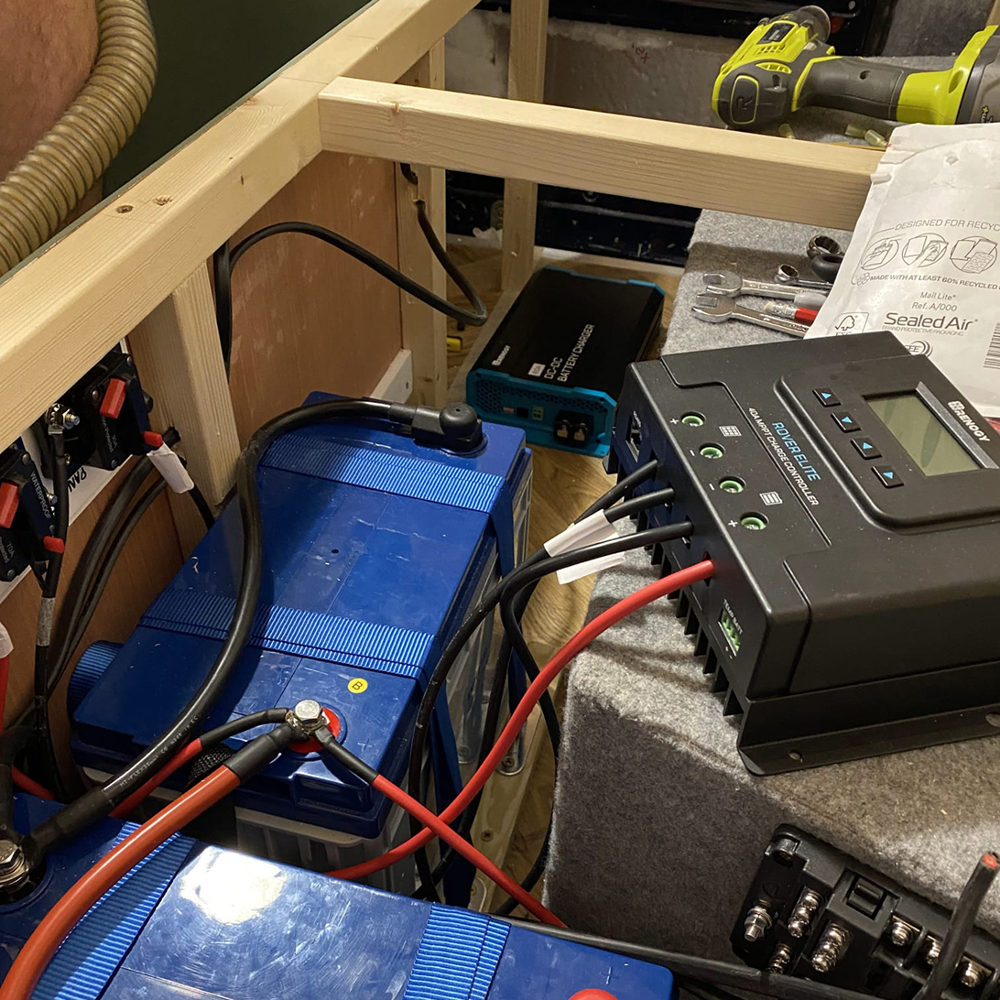
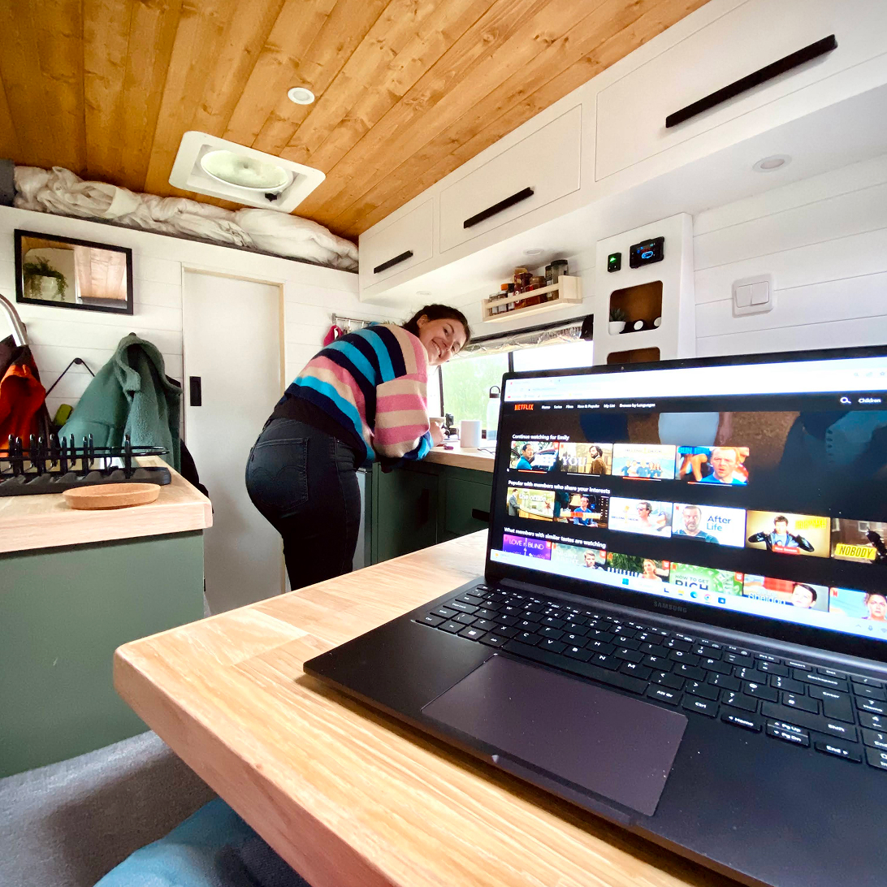

+++
title = "Campervan electrics: Do you really need mains power in your campervan?"
date = 2026-04-03
draft = false
tags = ['vanlife','electrical']
image = "van-conversion-electrical-2021.jpg"
description = "Thinking about mains power in your campervan? Discover why a 12-volt system can be more efficient, how to charge laptops with USB-C, and tips for powering devices like TVs, blenders, and vacuums while travelling off-grid."

+++

If, like us, you've been endlessly researching whether or not to have mains power, then we’re here to explain why you don’t necessarily need this and can get away with using a simple 12-volt system only.

When we were building our campervan, we decided to only have a 12-volt system. We knew we wouldn’t be using high powered appliances and because we were converting a medium wheel base van, we wanted to save space wherever possible.

## What is the difference between mains power and 12-volt in a campervan?

12-volt systems can typically run directly from your leisure battery, as most leisure batteries are already 12-volts. You can run many low voltage appliances, like LED lighting, electronics designed for motorhomes such as water pumps, compressor fridges, roof fans and typically anything that runs off USB, like phone chargers, consumer electronics and some laptops.

Mains power, on the other hand, requires a higher voltage level, usually 120 volts (in the US) or 220-240 volts (in Europe). To use mains power in your campervan you will need to install an inverter in your electrical setup. This will take the 12-volt supply from your leisure battery and convert it into mains power, allowing you to use higher wattage items found within the home, for example, an air fryer or a blender.

## Reasons to choose a 12-volt electrical system in your campervan build

Everyone has different needs and priorities, but for us, a 12-volt system fitted well with our build. We built our van with the intention of long term travel and working on the road, so we needed enough power to charge our electrical devices and have the ability to be off-grid.

To sustain ourselves off-grid, especially during the winter with limited solar energy, we steered clear of power hungry appliances. We had no need for appliances like hair dryers, power tools, or any high-wattage items.

With that in mind, here’s why we think that choosing a 12-volt system is a great way to go for your campervan build.

1. **Cost effective:** Having a 12-volt system will save you money as you won't need to purchase the additional equipment required for a mains power setup
1. **Simplified set-up process:** With a 12-volt system, your electrical installation will be more straightforward, saving you time and effort, especially if you haven’t done any electrics before. There is no need to worry about installing inverters and adding more wires to the mix.
1. **Maintenance and troubleshooting:** In the event of any issues, resolving the problem becomes more manageable, because your setup is simpler, even for those with limited knowledge or experience.
1. **Minimalist lifestyle:** Having a 12-volt setup encourages you to prioritise your essentials and live a more minimalist lifestyle. This is important with the compact living space of a campervan. How often are you really using a blender?
1. **Stay off-grid for longer:** If you're seeking an off-grid way of living, a 12-volt setup is ideal. The efficiency of low power appliances means they draw less power from your batteries, making them last longer.
1. **Space saving:** In a smaller van, every centimetre counts. By using a 12-volt system, you eliminate the need for bulky inverters and chunky fuse boxes that are designed for use in the home. Whereas 12-volt system components are designed with tiny living in mind. This saves valuable space in your campervan, allowing for more storage solutions and maximising usable living space.

## Why using mains power in a campervan can waste energy

To use mains power in your campervan, an inverter is required to convert the 12-volt DC power coming from your leisure battery into the higher voltage AC power required to work your mains powered appliances. Unfortunately, there’s some energy loss that occurs during the conversion process, this is usually only 5-10% but this can be higher if you’re using a lower quality inverter.

Then there’s the issue of standby power consumption. Even when your devices are turned off at the wall, inverters continue to draw a small amount of power to maintain their operation. The larger the inverter, the more energy it consumes just to keep itself running, so you’ll need to remember to turn it off when you’re not using it.

By minimising your reliance on inverters and sticking to low-wattage DC appliances, you can significantly reduce energy waste and maximise your battery life. Plus, you’ll save space and weight in your campervan which is essential if you are working in a small space. We converted a L2H2 Citroen Relay (medium wheel base) and have a dinette layout, and knew having both an inverter and a fuse box would reduce our storage space.

## Do you need mains power to charge a laptop in a campervan?

You might assume mains power is essential for charging a laptop, but that is not always the most efficient option. In many cases, you can charge your laptop directly from your 12-volt system instead.

Laptops run on DC power. When you use a standard charger with mains electricity, the adapter converts AC power into DC. If you charge via an inverter, your system first converts 12-volt DC power into AC, and then the laptop adapter converts it back into DC again. Each of these steps results in energy loss.

Charging your laptop directly from a 12-volt system avoids these unnecessary conversions, making it a more efficient solution.

### Using a USB-C car charger to charge your laptop

If your laptop charges via USB-C, you can use a USB-C car charger instead of mains power. Our Lenovo ThinkBooks use USB-C, so we installed dedicated 12-volt sockets in our campervan and plug the chargers directly into those.

It’s important to make sure your 12-volt sockets are suitable for this. Some are only designed for low-power devices like phones and may not handle the higher power needed for a laptop. Using an underrated socket can lead to overheating or damage. We also used a suitable thicker gauge wire that could safely handle the higher load.

Before buying a USB-C car charger, check your laptop’s power requirements. Chargers come in different power levels (measured in watts), typically from 20W up to 100W or more, and you’ll need one that can supply enough power for your laptop.

It’s also important to check the charger itself. For example, some chargers have two USB-C ports and advertise a total output of 60W. That 60W might be split between the two ports, giving only 30W per port. Make sure the charger can deliver the full wattage your laptop needs on a single port to charge efficiently.

For example, we currently use 45W chargers for our Lenovo ThinkBooks. They do work, but they’re slightly underpowered, so charging is slower than it could be. When we first bought them, there weren’t many good higher-wattage options available, but there are more on the market now, so we plan to upgrade. As a comparison, a MacBook Pro needs around 96W to charge at full speed.

You can use a lower wattage charger than your laptop requires, but it may charge slowly or struggle to keep up while you’re using the laptop.

This [USB-C car charger from UGREEN](https://amzn.eu/d/08l0aomq) should be able to power even the most demanding laptops. It has multiple ports, but one of them delivers 100W on its own, so you can use that port for your laptop while still charging smaller devices like phones or tablets from the other ports.

### What if your laptop doesn’t support USB-C charging?

Even if your laptop doesn’t support USB-C charging, you could consider purchasing a universal car charger with various connector types, such as this [TAIFU Universal Laptop Car Charger](https://amzn.to/4aQMqHf) on Amazon.

## How can I live without a…

Anyone going from house living to a campervan will take these day to day items for granted and wonder how this is achievable when travelling around in a campervan. Here are some more frequently asked questions around powering devices in your campervan.

### Hairdryer in a campervan
You can buy 12-volt hair dryers, but from what we’ve read online these won’t provide a lot of heat. For hair styling there are a lot of heat free products out there which would be perfect for a campervan lifestyle.

For us, we’re happy to let our hair air dry, especially in the summer. If you have a heater installed in your campervan for the winter, a great hack is to use this as your hair dryer! For it to be even more effective, you could use some flexible pipe which can fit over the heater for more direct heat, [as shown here by True Blue Travellers.](https://www.youtube.com/shorts/MmU-t_yWvNw)

### Airfryer in a campervan
The only way to use an airfryer in your campervan is to install mains power. If you have the space to store an airfryer and a mains power system in your campervan, you may opt for this easy way of cooking. However, remember an airfryer will require a lot of power and will drain your batteries quickly!

### Vacuum cleaner in a campervan
Sometimes an old school dustpan and brush doesn’t quite do the job properly when it comes to cleaning your campervan. A lot of people travelling in campervans will pack a handheld household vacuum, however, this again will require an inverter in order to charge it back up again. If you’re planning to have a 12-volt system, there are many low voltage vacuums out there which do a great job. We use the [eufy Cordless Handheld Car Vacuum Cleaner](https://amzn.to/3PQ5jSy) which charges via USB and is one of favourite things we’ve bought for our campervan.

### Blender in a campervan
From doing some research online, there seems to be 12-volt blenders on the market. However, similar to a hair dryer, these won’t have the same amount of oomph as a household blender. A good blender will need a lot of power, so if having a blender is essential for you, then installing an inverter is the way to go.

### TV in a campervan
You can buy 12-volt TVs online, but they can be expensive and, in our opinion, a bit outdated now that laptops and tablets are so common and often more practical. With so many online streaming and on-demand platforms available, using a laptop or tablet as your “TV” is often the simplest solution. You could even mount a tablet on the wall for convenience.

However, if there are more than two people in a large campervan, a bigger screen might be worth it. In that case, a 12-volt TV or using an inverter with a larger TV could be a better option.