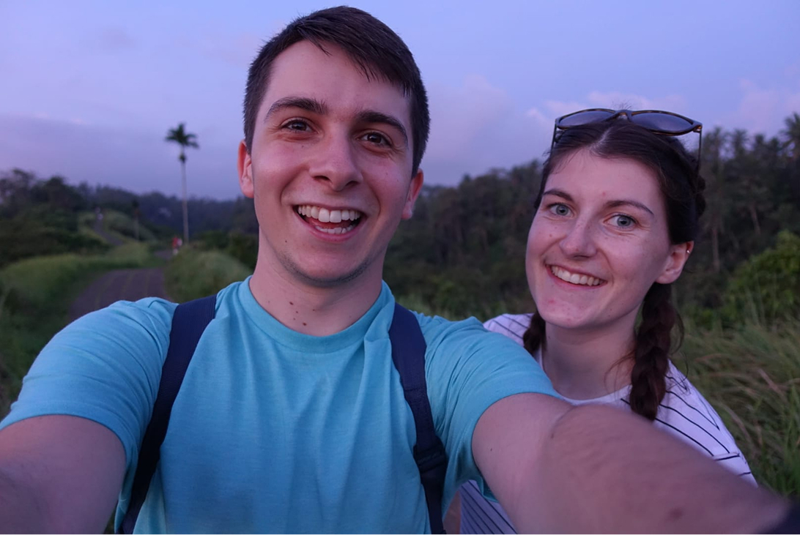
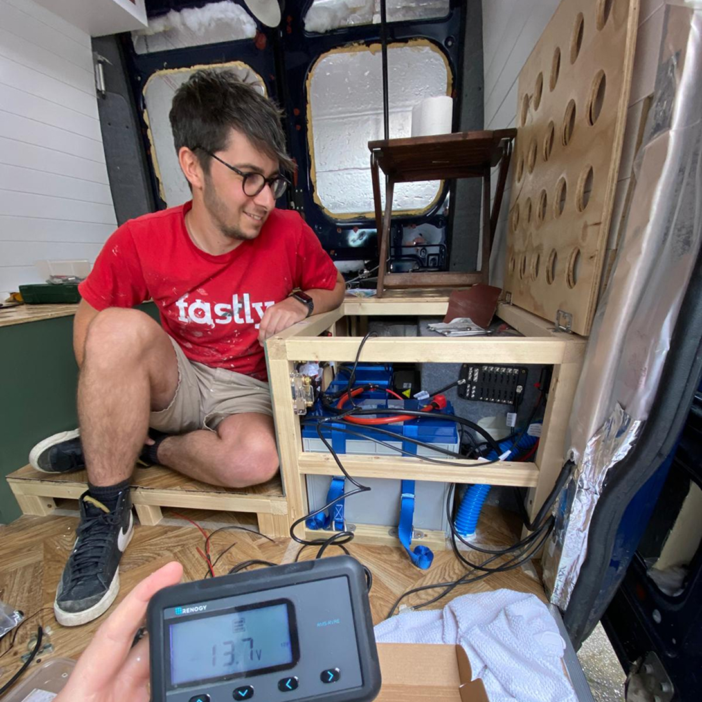
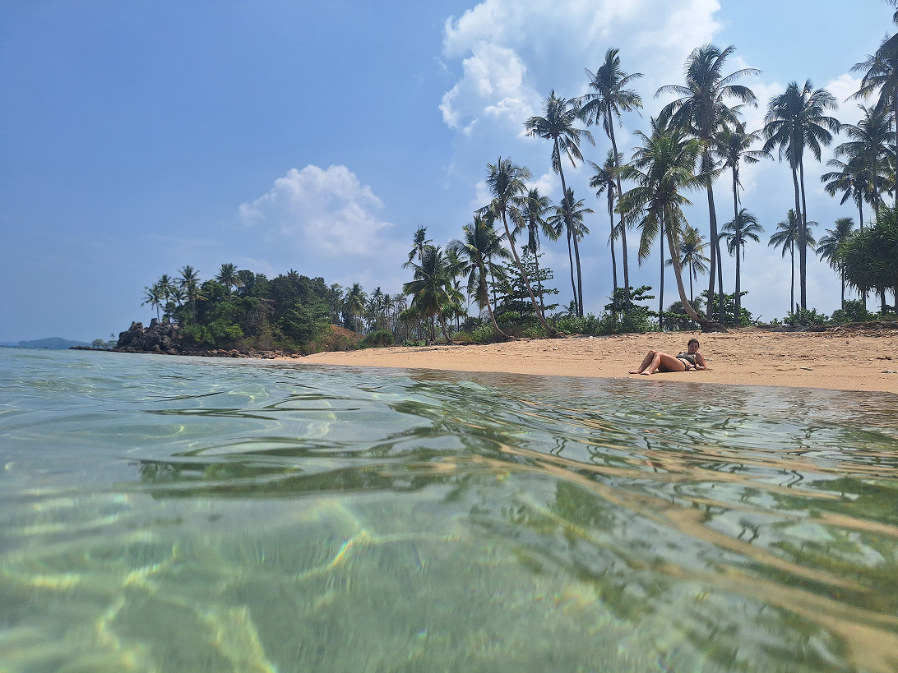
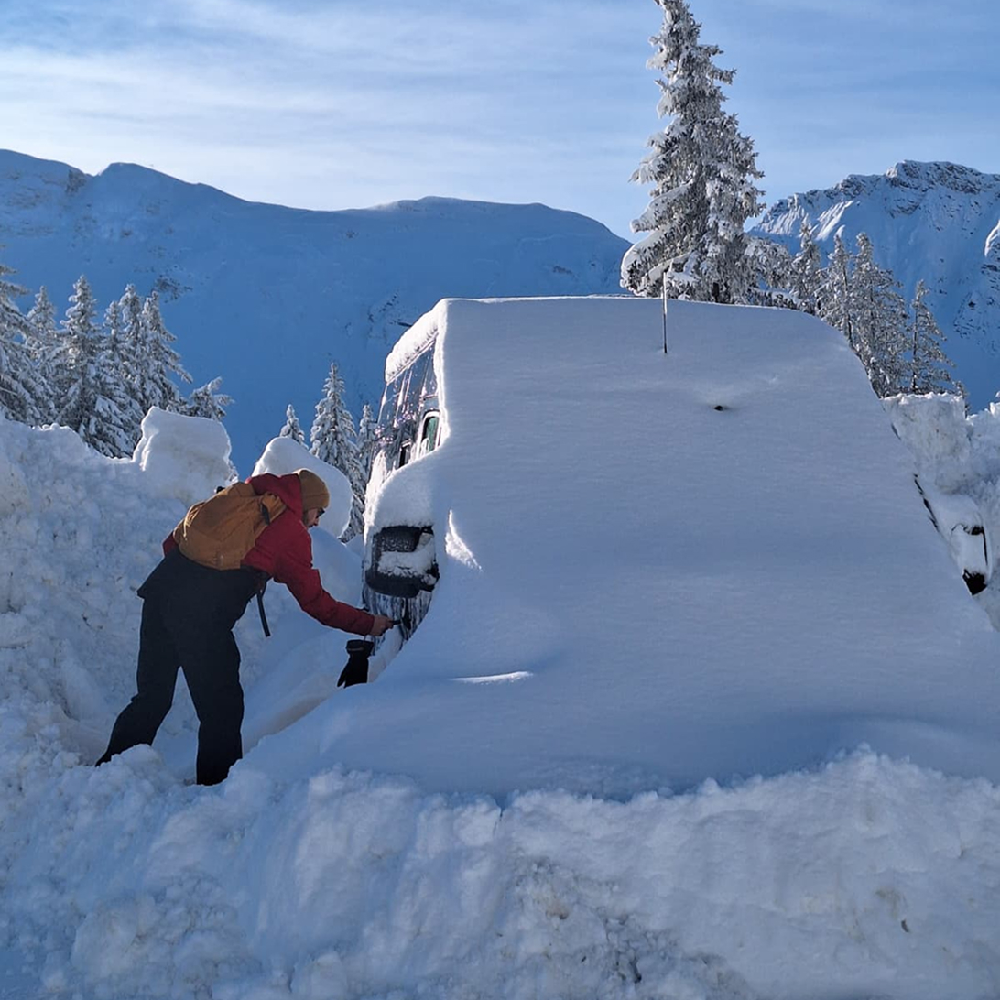

+++
title = 'Our Story: From Office Jobs to Van Life and Backpacking'
date = 2026-04-02
draft = false
tags = ['Lifestyle','Travel']
image = "our-story-photo.jpeg"
description = "Charlie & Emily traded office life for van life and digital nomad backpacking adventures. From travelling full-time in Europe to exploring Thailand and Cambodia, and skiing in the Alps, follow their journey of remote work, van conversions, and life on the road."

+++

Hi, we’re Charlie & Emily. In 2023 we left our full-time jobs behind to travel in our self-converted campervan.

Our love for travel goes back to when we first met in 2015. Since then, every spare moment became a chance to hop on a plane and explore new places. After years of short trips, we wanted something more. In 2020, we took a sabbatical and spent six weeks exploring Southeast Asia, travelling through Thailand, Laos, and Vietnam.



During lockdown, Charlie’s fascination with campervans grew, and I (Emily) quickly became hooked too after countless hours watching van life videos. We started saving, planning, and dreaming of hitting the road, and by April 2022 we had bought our van. Over the next eight months, we balanced full-time work with converting our van, ready to begin our adventure in February 2023.

For the first year, we travelled full time living on our savings, planning to eventually return home. Along the way, the idea of working remotely — or living a digital nomad lifestyle — felt like a bit of a dream, especially as my (Emily’s) previous roles weren’t particularly remote-friendly. After returning to the UK in the van, I did some seasonal work on a vineyard, and over time managed to secure a remote position in ecommerce. With Charlie freelancing as a web designer, everything shifted — suddenly, a more sustainable version of van life and digital nomad travel became possible.

Since then, we’ve spent extended periods travelling in the van across Europe, mixed van life with remote work, and taken breaks to escape the UK winter by flying to Southeast Asia, exploring Thailand and Cambodia as digital nomads on the move. Most recently, we’ve completed our second ski season in the van in the Portes du Soleil, combining work, travel, and life in the mountains.

Through it all, van life has given us the chance to chase new experiences, embrace the unexpected, and build a lifestyle that blends travel with remote work. This blog is our space to document that journey — from van conversions and Europe road trips to ski seasons and backpacking in Southeast Asia — for anyone interested in van life, long-term travel, or the "digital nomad" way of life.

