+++
title = "Winter van life: Two ski seasons in the Portes du Soleil living in our campervan"
date = 2026-11-13
draft = false
tags = ['van life', 'skiing', 'Travel']
image = "20240121_162214.jpg"
description = "Planning a ski season in the Portes du Soleil by campervan? Here's what worked for us, from where to park and stay to winter readiness, costs and internet."

+++

Living and skiing out of a campervan for the ski season? Most people think we’re a bit mad. Cold weather, van life, surely it’d be miserable? But we’ve now spent 300 nights across two ski seasons in our van, in the Portes du Soleil (PdS). PdS is a huge ski area spanning France and Switzerland that’s home to Avoriaz, Morzine, Châtel and more, and we’d do it again tomorrow.

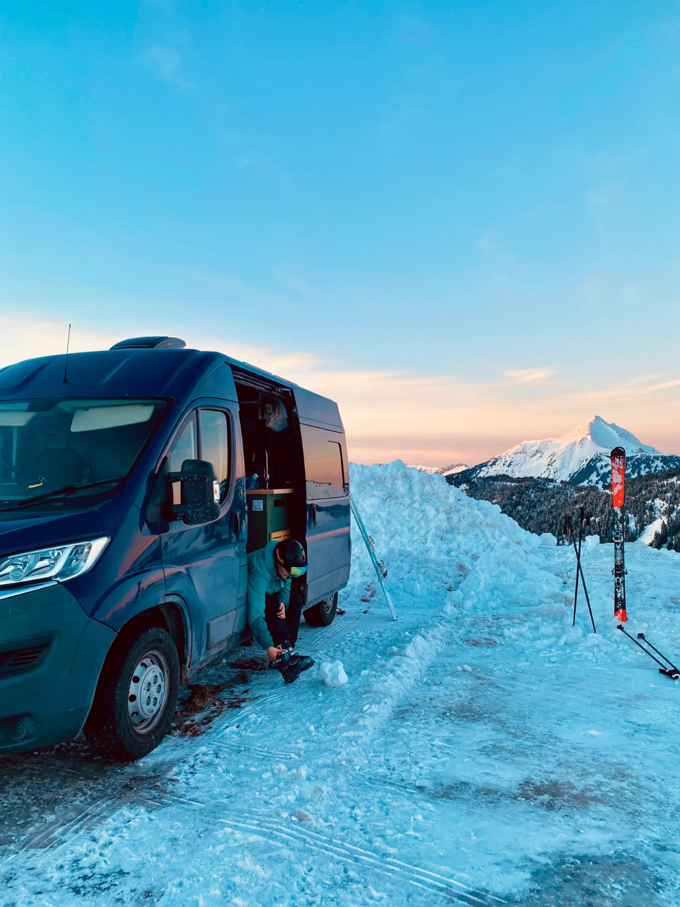

‘Doing a ski season’ is a dream for many. The usual way is getting a job in resort with free accommodation, and that’s a brilliant option. But you’re often tied to a work schedule without the freedom to move wherever the snow is best and that can limit how much of the mountains you actually get to see. We think winter van life is another way to do it.

When we first thought about doing this, we wanted to find the most van-friendly places to ski and found that many in France are and that the Portes du Soleil is particularly campervan-friendly. The region has lots of overnight parking spots and services we’ll cover in detail later. We’ve visited other ski areas in France too: Alpe d’Huez, Saint-Gervais, Chamonix and La Rosière. Plus 4 Vallées and Aletsch Arena in Switzerland. We found good spots in those areas, but we always come back to the Portes du Soleil for so many reasons. It feels like our ‘winter van life’ home now\!

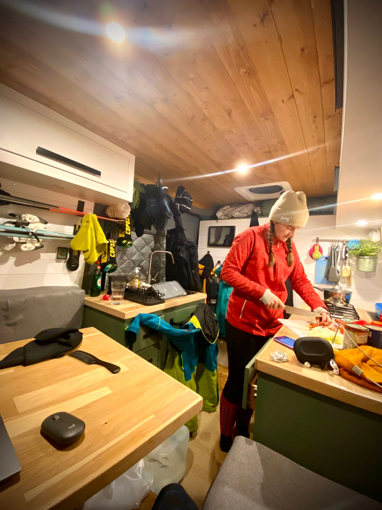

With the right prep, it’s warm, cheap and a lot more comfortable than it sounds. Here’s what we’ve learned about chasing powder in a van, on a budget over two seasons.

---

## Why the Portes du Soleil ski area works so well for winter van life

Spanning 12 resorts across France and Switzerland, the Portes du Soleil is one of the biggest ski areas in the Alps, so there’s that. There’s 600 kilometres of pistes and 208 ski lifts reaching 2,460 metres. The scale of this area is one of the reasons it makes sense to spend a whole season here, there’s a lot to explore.

We’ve now spent 300 nights in our van across the region, staying at mostly free overnight spots without any issues. We spent most of our time parked in Avoriaz at 1,800 metres, in temperatures as low as \-15°C (5°F)\! We’ve also stayed at plenty of spots at around 1,000 metres as well. Most of the spots we stay have ski-in and ski-out access. You can feel quite spoiled even while living out of a van in a ski resort, because you can get so close to the pistes.

There’s more than skiing too. The region has hiking and snowshoeing trails, dedicated sledging slopes, nordic skiing paths, and backcountry too. Some resorts also have a lively après-ski scene, notably Morzine, and some resorts host music festivals throughout the season.

## Where to fill water, empty waste and find power in the Portes du Soleil ski area

If you’ve been to France in a van before, you might have heard of Flot Bleu stations, there’s a few of these scattered around the Portes du Soleil. Basically, they're large blue boxes with a freshwater tap, toilet hole, and rinsing tap. Flot Bleu stations are designed specifically for campervans and are protected from freezing too. The [Flot Bleu website](https://flotbleu.com/recherche) has a map of all their locations. They cost around €3 to use and accept contactless payments. Once payment is made the insulated door unlocks and you get 20 minutes to use the station. We love the Flot Bleu stations, they make winter van life in France really easy.

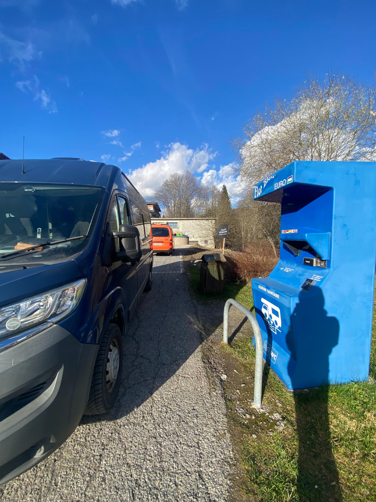

We deliberately designed our van setup to be quite simple in case we ever went to regions where campervan infrastructure is more scarce. So instead of a chemical toilet, we use a separating toilet, which gives us more flexibility with disposal.

**Electric hookups for campervans in winter**

Electric hookup points for vans feel like gold dust across ski resorts in winter. Many vans use the sun for juice in the summer, so it seems everyone is hunting for a plug over winter, meaning the few available posts in an area can be full. We’ve even seen people prying open lampposts to wire up a plug; don’t be like them\! We recommend having another way to charge your leisure battery. We’ve outlined where you can find power in the region in specific locations below.

**Where to shower in winter**

If your van doesn’t have a shower (ours doesn’t\!), some of the ski resorts in the region have swimming pools and sports centres with showers; more on specific resorts below. Otherwise, if you’re feral like us, a regular flannel can go a long way\!

**Where to refill your LPG**

If you have an underslung LPG tank like us, note that there are no LPG refill stations in the resorts. You’ll need to go down the mountain to Cluses or Thonon, both are around a 40-minute drive (28 km) from Morzine, or about an hour drive (42 km) from Avoriaz.

* Fuel station with LPG in Cluses
* Fuel station with LPG in Thonon

We only use gas for cooking and heating water for washing up, so we only need to refill every couple of months, but if you use gas for your heating, you’ll be filling up more often.

---

## Where to stay in your campervan overnight in the Portes du Soleil in winter

After spending at least 300 nights in our van across the Portes du Soleil over two ski seasons, we feel like we have some authority on this subject. Sleeping in ski resorts has felt very safe and really fun\! We prioritise being next to the slopes or at least near a ski bus stop. Being in a campervan means you can often be closer to slopes than you’d ever be in a chalet, especially if you’re used to skiing on a budget.

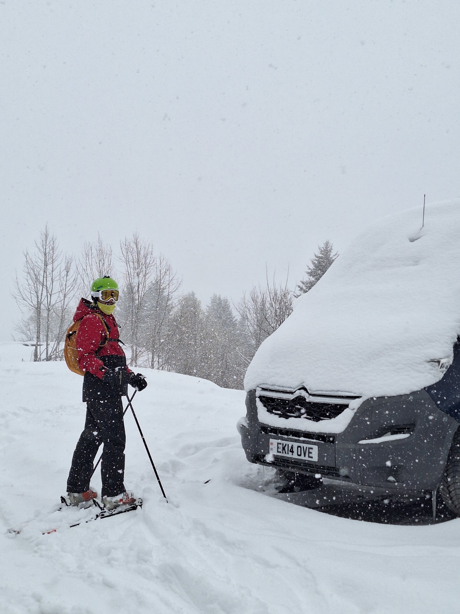

**The TLDR: Our favourite overnight van spots in the Portes du Soleil**

* Les Gets (best all-rounder with access to facilities)
* La Chapelle-d’Abondance (quiet, excellent for longer stays)
* Avoriaz (great ski-in/ski-out access)

We’ve listed the main places we’ve stayed overnight in the van below, pulled from a Google Maps list that we’ve slowly built up over two ski seasons here. If you’d like us to share it with you, send us a few quid on PayPal for our fuel fund and we’ll send the link to your PayPal email address.

### Les Gets

Les Gets is linked with Morzine to form the Les Gets–Morzine ski resort; it has 120 km of pistes, 48 lifts and slopes for all abilities. You can also access the Mont Chéry ski area here. The town is great for families but has some lively bars too. Located at 1,172 metres, with skiing up to around 2,000 metres. Les Gets is one of our favourite van spots with access to a bit of civilisation, it’s got a lovely feel to the place\!

**Quick overview**

* **Altitude:** 1,172 metres with skiing up to 2,000 metres
* **Ski area:** Les Gets–Morzine, 120 km of pistes and 48 ski lifts, plus Mont Chéry ski area
* **Best for:** All-rounder with access to facilities; family-friendly with some lively bars
* **Van parking:** Official aire at the bottom of a red piste and chairlift
* **Services:** Flot Bleu, waste bins, waste hut in the aire and multiple supermarkets
* **Getting to the village:** 20-minute walk, or a free bus day or night

**Official motorhome aire in Les Gets**

The campervan parking location in Les Gets is great because it’s at the bottom of a red piste and chairlift. The main village is only a 20-minute walk (1.3 km), or you can hop on a free bus, day or night. There’s a Sherpa supermarket a 4-minute walk (270 m) from the aire and a larger Carrefour supermarket in town.

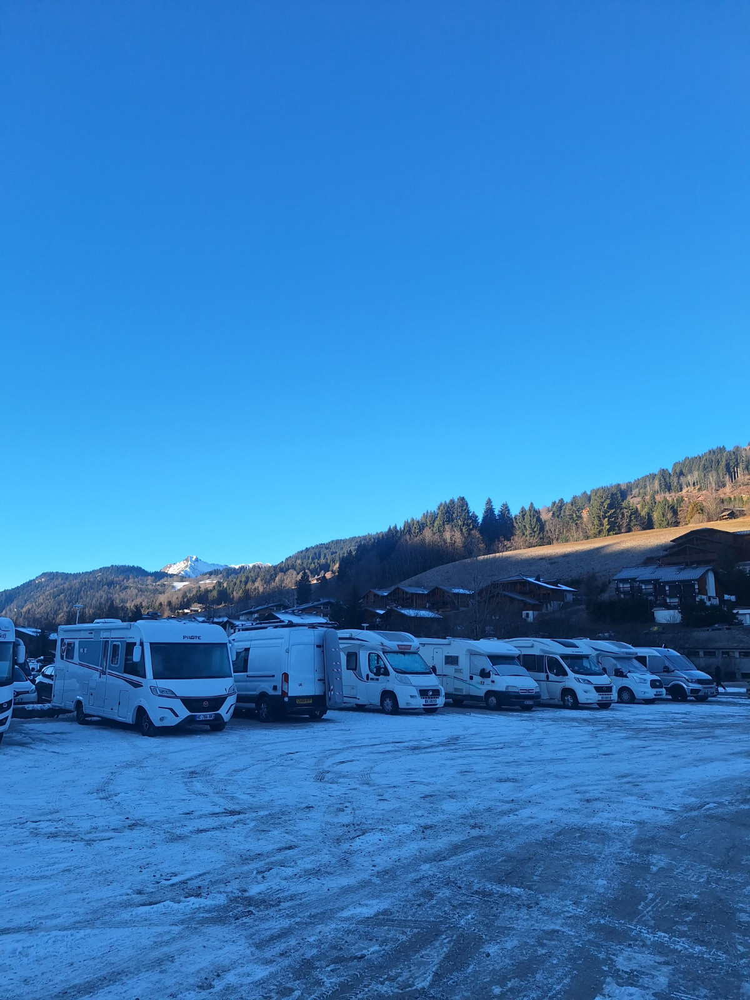

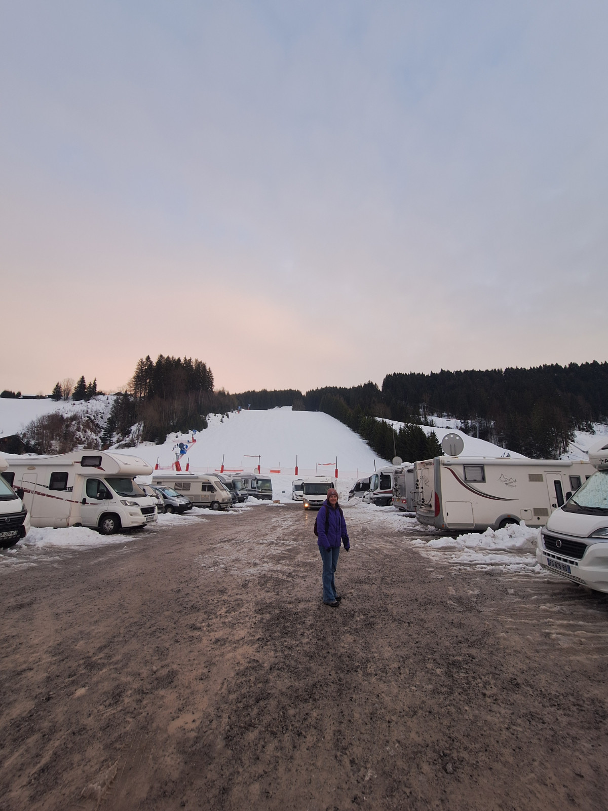

The aire has a sign listing the nightly rates; €35 for 3 nights for example, it states that the maximum stay is 7 nights and that payment should be made at the village hall. We’ve heard that police occasionally come around to collect fees directly, but during the weeks we spent here across the season, no one ever came by to collect fees.

For services, there’s a small wooden hut in the aire with a hole to dump waste inside. There’s also a Flot Bleu station and waste bins across the road.

### Morzine

Morzine neighbours Les Gets with 120 km of pistes, 48 lifts and slopes for all abilities. The town is located at 1,000 metres and the highest summit in the ski area is around 2,000 metres. The town has the liveliest après-ski in the Portes du Soleil; we think Cavern Bar is excellent for a night out. There’s many supermarkets here. From Morzine, you can also access better skiing in Avoriaz via the Super Morzine gondola when the snow depth is poor.

**Quick overview**

* **Altitude:** 1,000 metres with skiing up to 2,000 metres
* **Ski area:** Les Gets–Morzine, 120 km of pistes and 48 ski lifts plus gondola to Avoriaz ski area
* **Best for:** Liveliest après-ski in the PdS and finding your feet
* **Van parking:** Busy official aire (we rank it low for vans) away from lifts
* **Services:** Flot Bleu, electric hookup and multiple supermarkets
* **Getting to the village:** 20-minute walk or free bus day and night

However, we rank Morzine low for campervan parking because we don’t like the official motorhome aire that much and local authorities have had issues with vans elsewhere in the village. We’d mainly come to Morzine in the van when we were looking for more of a social vibe with good après-ski and food options.

**Official motorhome aire in Morzine**

The official motorhome aire is a 20-minute walk (1.3 km) from the town centre, but there’s a free ski bus stop across the road. You then get off the bus at the Pleney gondola to reach the ski area or get off at the Super Morzine gondola to go up to Avoriaz instead.

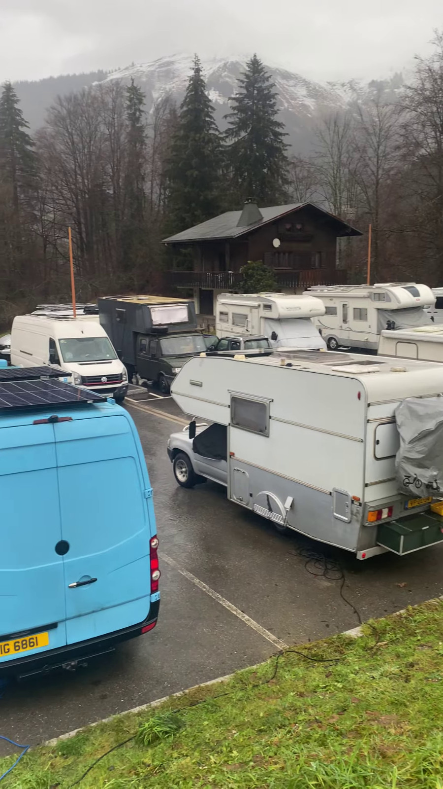

We often found the Flot Bleu service station here out of order and the aire is often full with long-term seasonaires, so it can be difficult to get a spot. The cost to stay was €11.50 during winter. It wasn’t our favourite for overnight parking, it’s quite busy, so we didn’t spend much time there but it can be a good place to start the season to find your feet (wheels?)\! It’s quite sociable and ‘hip’, if you like that?

Electric hookup is available here, one of the few places you can hookup in the Portes du Soleil, but you might find yourself needing a long cable or connected via half a dozen extension leads shared with other vans.

### Avoriaz

Located at 1,800 metres, Avoriaz is the highest resort village in the Portes du Soleil. It’s an 18-minute drive (12 km) from Morzine. The village itself is pedestrian-only in winter, but parking is available on the edges. It’s accessible from many lower resorts via lifts and slopes.

**Quick overview**

* **Altitude:** 1,800 metres, the highest resort village in the PdS
* **Ski area:** 75 km of pistes and 34 ski lifts with access to other resorts
* **Best for:** Ski-in/ski-out access, maximum snow and good après-ski
* **Van parking:** Free car parks or the paid resort entrance car park
* **Services:** Public toilets only, Working Centre in the village and multiple supermarkets
* **Getting to the village:** Varies on where you park (see below)

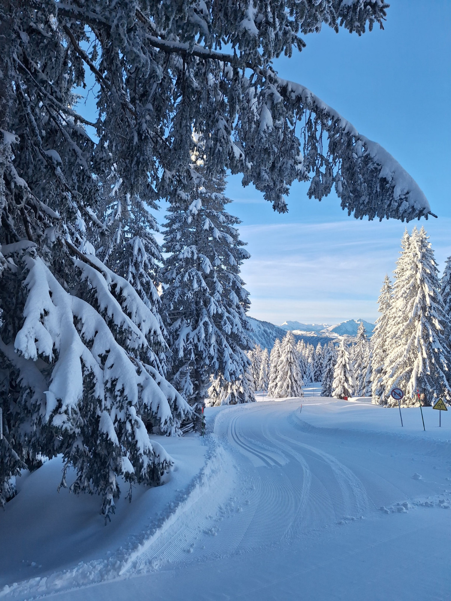

We love Avoriaz in the van as it gives you the best of both worlds. It feels a little remote up there, but you’ve got access to the village which has lots to do. The après-ski is good but more relaxed than Morzine (which works for us\!). However there are music festivals here during the season and a La Folie Douce bar (IYKYK\!).

Due to its higher altitude, it is often snowing up here in Avoriaz when it’s raining in Morzine. It’s a good spot to get maximum snow but the conditions are more intense because of it. Expect colder temperatures up here and more chance of getting properly snowed in, but that’s part of the fun, isn’t it?

**Free chairlift parking on the way up to Avoriaz**

There’s a free small car park as you drive up to Avoriaz, it’s busy with cars during the day, but often quiet at night. The chairlift there gives you access to Avoriaz with great ski-in/ski-out on blue pistes. The top of the Super Morzine gondola is also here, so you could go down to Morzine town during the day also. There’s no ski bus stop here, though, and it’s a little far from Avoriaz village if you want to reach it after the lifts close.

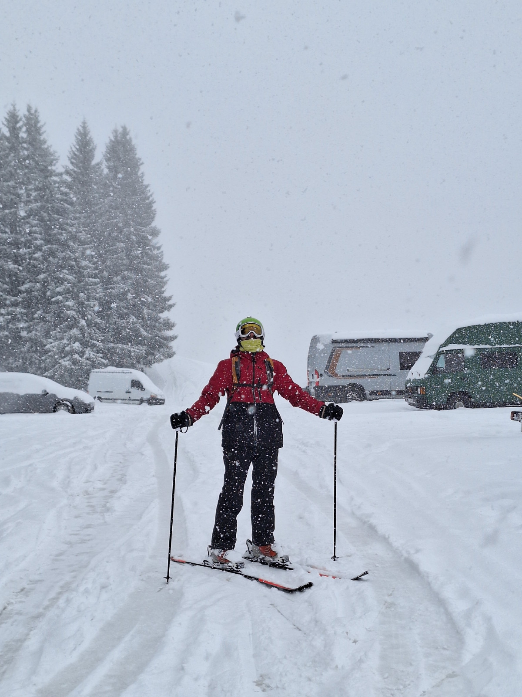

**Free parking near the farm in Avoriaz**

This is one of our favourite spots\! This is closer to town than the previous spot with direct piste access also, even for beginners on a green piste. There are 2 small parking areas and one huge one just off the main road. Busy with cars during the day but it’s deserted at night and the road is quiet since it’s just a dead-end with Avoriaz village. There’s also a 24/7 public toilet up here.

There are walking routes accessible from this spot and Avoriaz village is a 40-minute (2.5 km) walk away, or take the bus from here during the day. We sometimes just put our skis on and skied to the Carrefour in Avoriaz for a baguette or a coffee from here\! We’ve also skied there in the evening and back along the walking trails after après-ski, but we obviously wouldn’t advise you to do this, stay safe out there\!

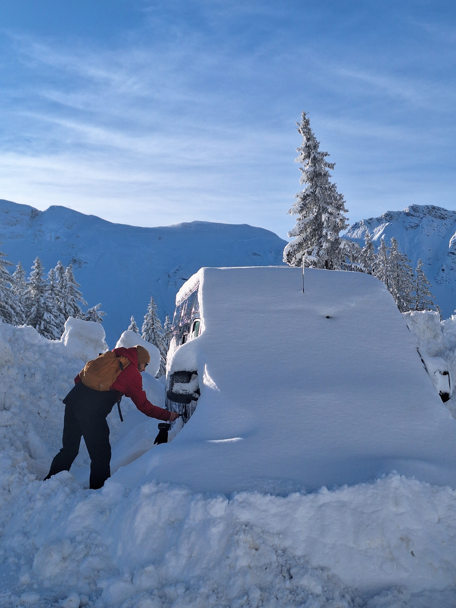

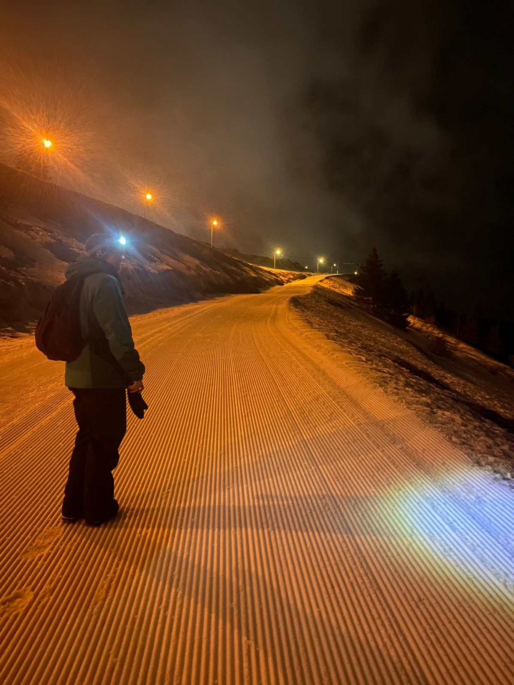

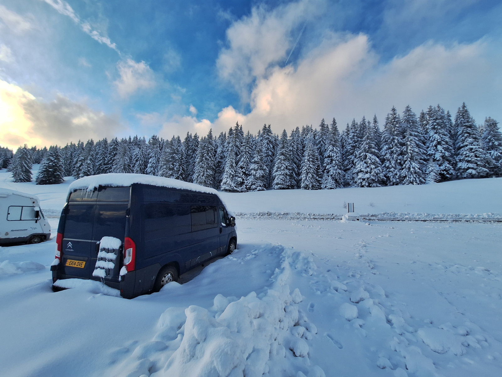

**Parking at the Avoriaz resort entrance**

The large outdoor car park at the resort entrance charges €13 per day. Many campervans park here alongside regular cars. Staff usually direct vans to the back of the car park which is a 4-minute walk (300 m) to the nearest slope. There are public toilets at the entrance, but no official campervan services. It’s convenient if you want to be close to Avoriaz town as it’s only a 20-minute walk (1.3 km) away.

**Honourable mention: Coworking space in Avoriaz**

This is worth knowing about if you need to get some work done in Avoriaz. One day last season there was an issue with the mobile internet signal in Avoriaz. We were also feeling cooped up and our backs were hurting from being in the van.

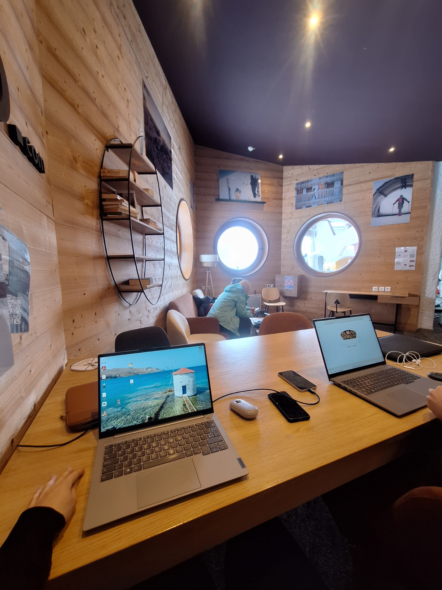

We found there’s a free coworking space in the resort, where you can use your laptop with free wifi. It’s called the Working Centre by Miliboo. The Working Centre is located near the Carrefour supermarket in Avoriaz. Miliboo is a French designer furniture brand, so we’re guessing it’s sponsored by them. It’s furnished really nicely, so thanks Miliboo\! It does get busy, though, and it is slightly depressing being surrounded by people working who should probably be enjoying their holiday\!

### Châtel

Châtel village sits at 1,200 metres, with skiing up to 2,200 metres and direct links to Avoriaz and the Swiss resorts. The slopes here usually feel quieter than Avoriaz. From Châtel, Avoriaz is a 1 hour 10 minute drive (50 km), but on skis it’s much closer. Parking in Châtel village itself is tough and the area is quite spread out, so don’t expect to be right in the village if you’re planning to stay here overnight in your van.

**Quick overview**

* **Altitude:** 1,200 metres with skiing up to 2,200 metres
* **Ski area:** 85 km of pistes and 41 ski lifts with access to other resorts
* **Best for:** Quieter slopes than Avoriaz, good après-ski and nice spa
* **Van parking:** Free ski lift car parks up the valley and on the edge of the village. Parking in the village itself is tough
* **Services:** Large Intermarché with Revolution automatic laundry and daytime electric hookup
* **Getting to the village:** Varies on where you park (see below)

Châtel village has a really nice aquatic centre with a spa called Forme d’O. It has three pools, one of them outdoors with scenic views, plus several saunas at different temperatures and a steam room. Entry is €25 per person, and we were sometimes let in to shower for free. The village has good vibes at night too: it’s pretty busy, and it seems to be a favourite with the Dutch as well. We really liked Bar La Godille for its cosy busy pub feel, and Wine@Yours is also well worth a visit for good music, and well, wine\!

All the parking options we mention for this area below are within a 10-minute drive (7.2 km) to the large Intermarché supermarket with a fuel station and a Revolution automatic laundry facility, super useful\!

**Free parking up the valley from Châtel village with two chairlifts to the Plaine Dranse sector**

There’s a huge free car park serving two of the main lifts to ski Châtel, and it’s the closest sector to Avoriaz. It’s very busy during the day but deserted at night. The ski-in/ski-out is excellent, even for beginners: you can ski back down a green piste to within just 2 metres of your van (not kidding\!). Free ski buses run to Châtel village during the day, and there are public toilets at the ski pass ticket booths, open during the day.

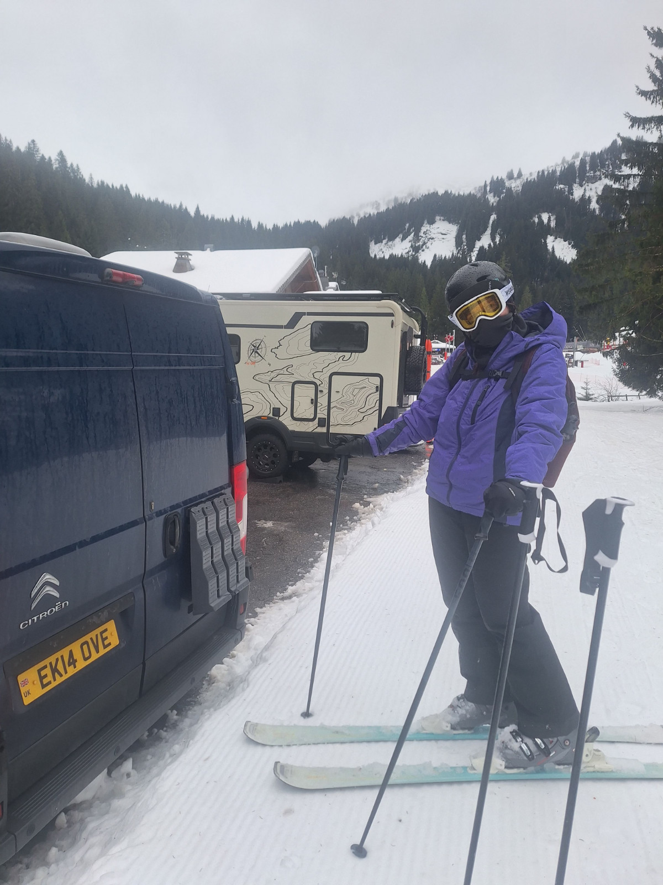

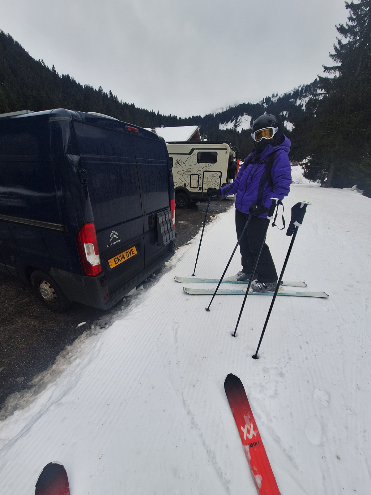

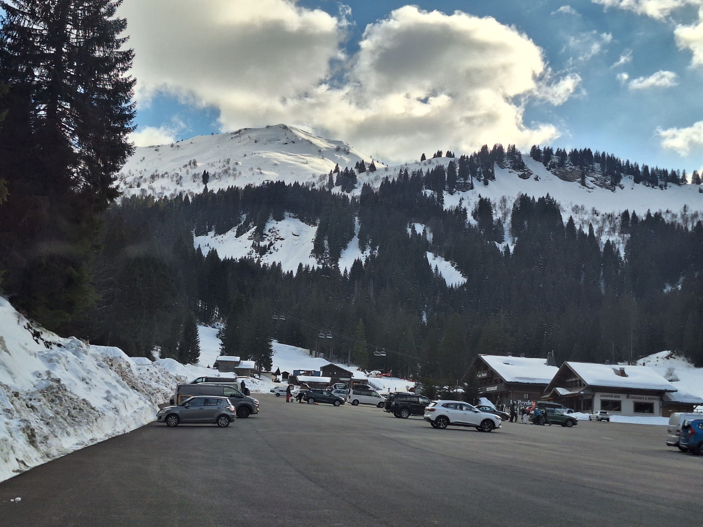

We spent Christmas Day here\! After a day on the slopes, we tagged along with a group of Dutchies for après at Chez Crépy (great music) up in the Plaine Dranse sector. Then we skied back down to the only bar/restaurant here for a few more drinks. We stayed here often, though when we needed to be closer to services we based ourselves in La Chapelle-d’Abondance, a 15-minute drive (11 km) away, and drove over in the mornings instead.

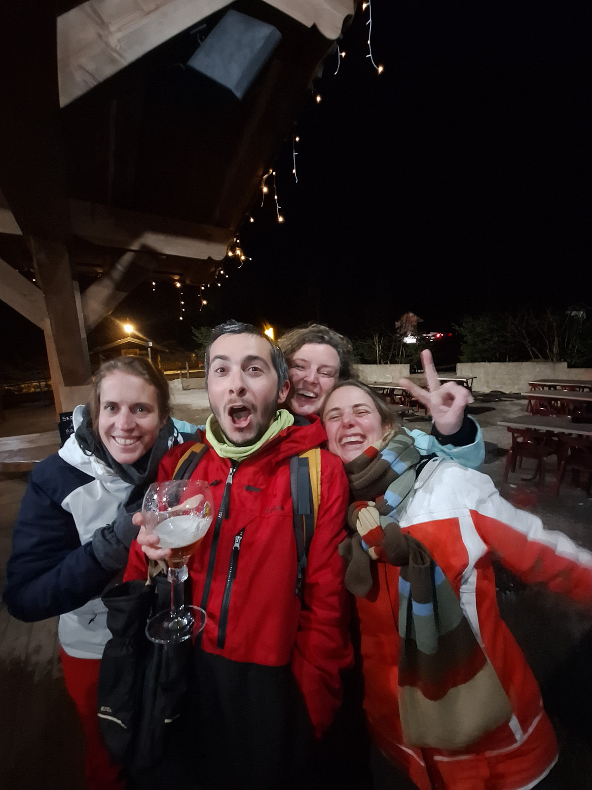

**Daytime electric hookup for charging up near Châtel**

There's also a spot around here where you can pay for daytime electricity hookup but you can't stay there overnight unfortunately, we think this is due to avalanche and rockfall risks in this area.

**Small free parking on the edge of Châtel village with chairlifts to the Linga and Super-Châtel sectors**

This is a medium-sized car park with direct access to both Châtel sectors as there are two chairlifts here. This is the only one close enough to walk to the village in the evening which is a 21-minute walk (1.8 km) where there are good après-ski and restaurant options. Unfortunately, mobile signal is very poor here and essentially unusable.

### La Chapelle-d’Abondance

This is a small, lesser-known resort at 1,000 metres on the French side of the Portes du Soleil, but it definitely doesn’t mean it’s not worth visiting, quite the opposite we think\! When staying in ski resorts in a van, the quieter, smaller resorts are often the hidden gems because they are the sort of resort you might not normally visit without your own transport.

**Quick overview**

* **Altitude:** 1,000 metres with skiing up to 1,620 metres
* **Ski area:** 35 km of pistes and 12 ski lifts with access to other resorts
* **Best for:** Quiet and a laid-back base for longer stays
* **Van parking:** Large official aire near the Crêt-Béni chairlift
* **Services:** Flot Bleu and large Intermarché with Revolution laundry nearby
* **Getting to the village:** 7-minute walk (450 m)

It has its own small ski area with 22 lifts and 75 km of runs. It’s low altitude, so it depends on the snow, but when conditions are good the local slopes can be very quiet and this place is a bit of a hidden gem\! The terrain is fairly limited, though you can also reach Torgon in Switzerland via the La Panthiaz gondola down the road, which gives you access to Avoriaz or Châtel if conditions allow. It’s also only a 15-minute drive (12 km) to the chairlifts in Châtel, so when we were based here we’d usually drive over there in the mornings, as we could access the best skiing more quickly.

We spent most of our second season here. It’s a quiet and laid-back area, you can enjoy some light skiing locally or drive to other nearby resorts as mentioned. Driving regularly also helps us keep our leisure battery topped up via the alternator.

There’s a nice flat riverside walk and more challenging hikes available from here. You can also hike up to the top of the Crêt-Béni chairlift, we did this a few times and had a nice beer at Restaurant Le Crêt Béni up there. They also do good charcuterie there and the prices are good. The village is small but has a handful of restaurants, bars, a shop, and bakery. You're only a 5-minute drive (3.5 km) to the large Intermarché supermarket with a fuel station and a Revolution automatic laundry facility. It’s also a 6-minute drive (5.2 km) to Châtel village.

**Official motorhome aire in La Chapelle-d’Abondance**

The aire is near the Crêt-Béni chairlift which gives you access to the small ski area mentioned earlier. The aire is large and doesn't get busy except during school holidays. A handful of seasonaires park here permanently in beautifully converted vans with log burners and big windows, we were quite jealous of their setups. The main village is a 7-minute walk (450 m) away. The aire has a Flot Bleu for waste disposal and fresh water (€2.50).

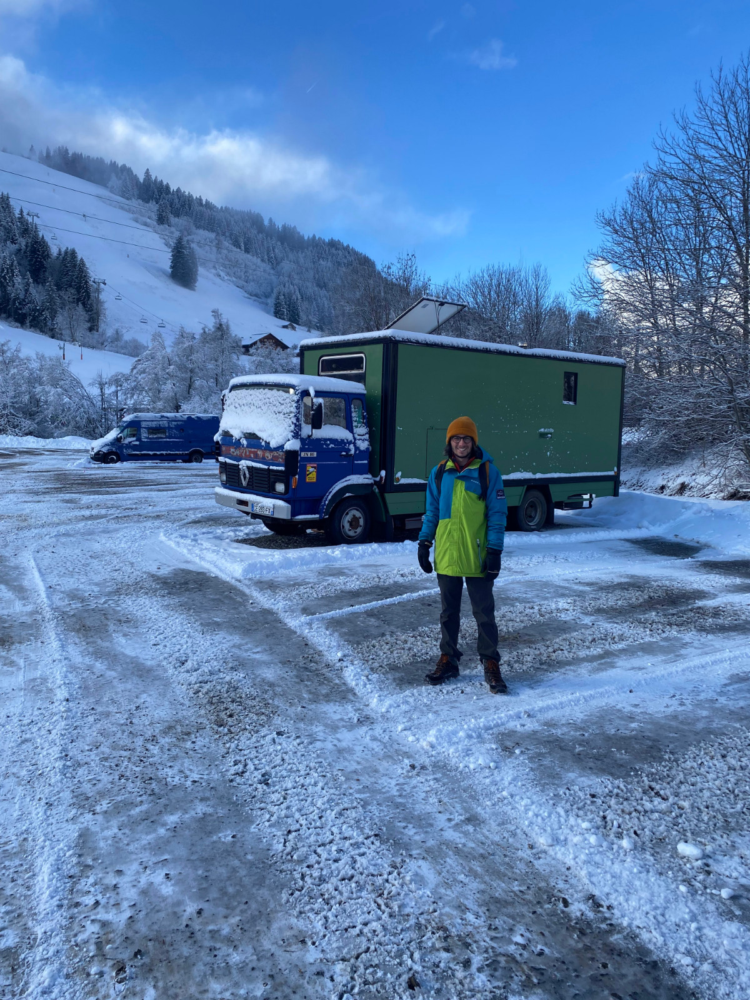

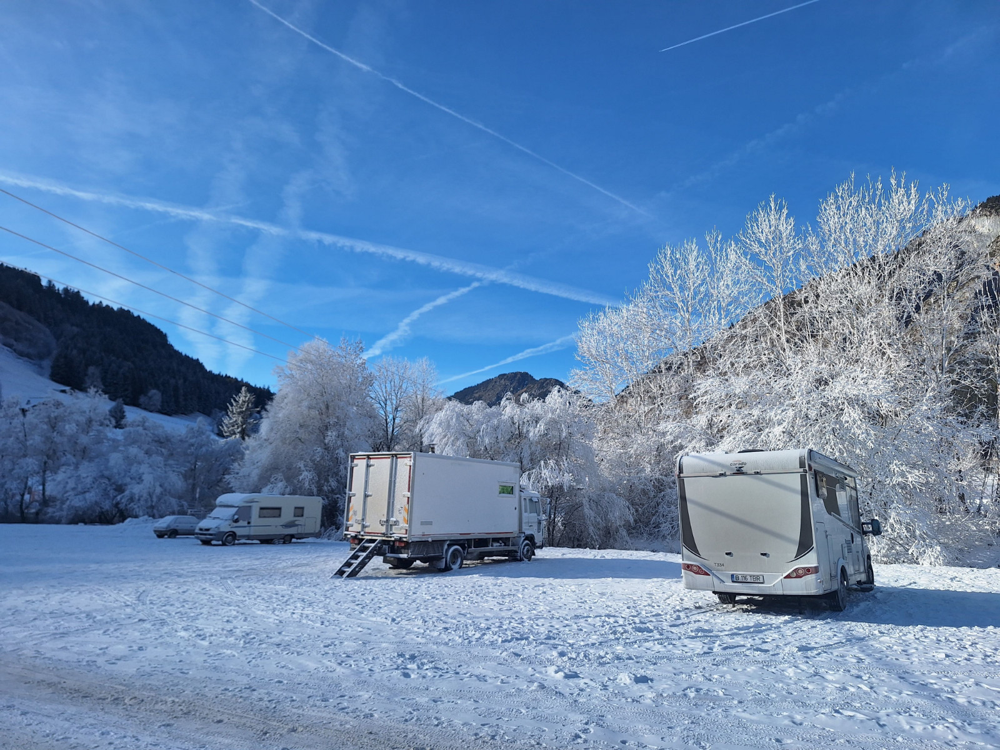

### Morgins, Switzerland

Tucked away on the Swiss side at around 1,350 metres, Morgins is one of the quieter corners of the Portes du Soleil, it’s a 7-minute drive (5 km) from Châtel or a 57-minute drive (43 km) from Morzine. It’s a small, sleepy village with a few shops and restaurants along the main road. It’s a very beginner-friendly ski area, there’s even a beginners slope accessible from the village. We loved how quiet it is in Morgins, and it has some really nice mountain bars on the slopes in Morgins and beyond.

**Quick overview**

* **Altitude:** Around 1,350 metres with skiing up to 2,470 metres
* **Ski area:** 50 km of pistes and 17 ski lifts with access to other resorts
* **Best for:** Electric hookup and exploring smaller resorts on skis
* **Van parking:** Free car park and about 6 official campervan spaces
* **Services:** Electric hookup, Flot Bleu and cheap showers
* **Getting to the village:** 10-minute walk or free day bus

We also found Morgins a good base for exploring some of the smaller resorts on skis, and you can get really far from here. We liked Champoussin and headed that way a lot from Morgins. We never parked there, but it might be possible, so have a look and let us know\!

This post isn’t meant to turn into a food and drink guide, but La Ferme à Gaby in Champoussin, Switzerland, deserves an honourable mention. We skied there and stopped for a break quite a few times, and a large bottle of Gösser beer was 6 CHF, which has to be one of the best prices for a large beer on the slopes\! It’s near the bottom of the Aiguille des Champeys lift, if you want to find it. Champoussin also has a ‘speed check slope’ as part of the Rivella Fun Zone, at the top of the Bochasses chairlift. You can time how fast you can ski down the steep run, and it’s very fun.

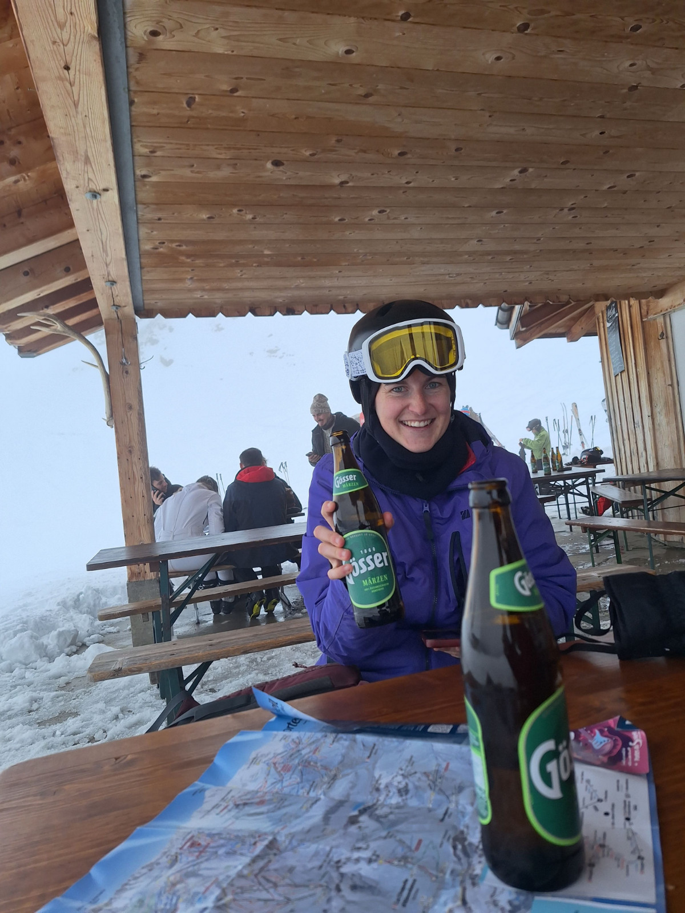

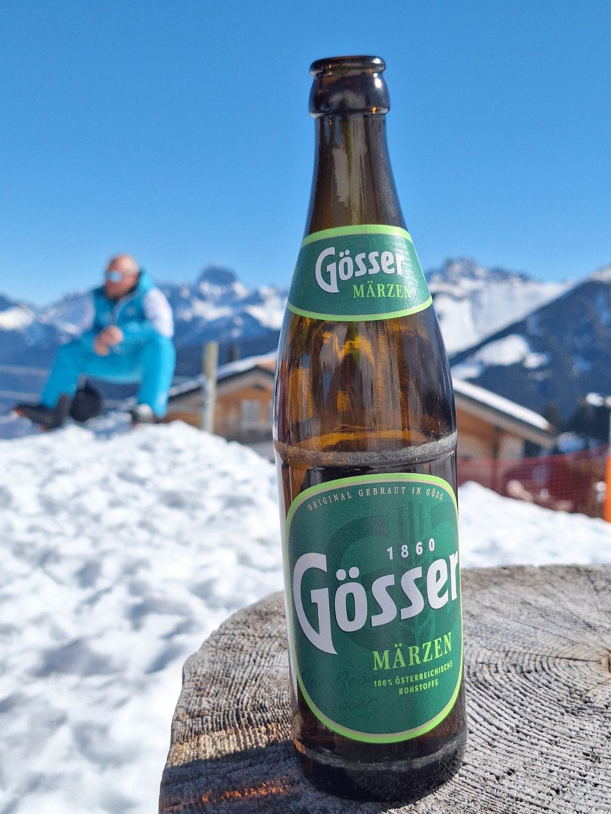

**Free parking in Morgins**

Morgins doesn’t have an official free camping-car aire, but there’s a free car park we used a few times. However, as Morgins is in Switzerland, stricter overnight rules apply, so you could be told to leave or fined (though we never were).

**Paid parking with electric hookup in Morgins**

In the same car park as above there are about 6 official campervan spaces with electricity. It cost 14 CHF per night and is managed by the sports centre opposite, you ask about it at the bar there, they’re very friendly\! They had good showers available for 3 CHF. We stayed here in \-14°C (7°F) during the depths of winter to hookup when our leisure batteries were running low. There’s a free ski bus stop opposite that takes you to the cable car that takes you up to the Morgins ski area. From there you can also access bigger resorts like Châtel and Avoriaz if conditions allow. There’s also a Flot Bleu for waste disposal and fresh water just around the corner, this was completely free to use also.

---

## Beyond these spots: the complete Portes du Soleil overnight parking guide for vans

We’ve shared our favourite locations in this post, but the region has many more spots that we’ve discovered across two full seasons. Over two seasons we’ve gradually built up a complete Google Maps list that includes the exact location of every parking spot we’ve tested, with notes on facilities, ski access and village proximity so we can revisit them later.

If this post has helped you plan your van life ski season and you’d like the full list, send us a few quid on PayPal for our fuel fund. We’ll send the link to your PayPal email address, so you can view the list right in Google Maps on your phone so you’ve always got it with you. Thank you\!

---

## The cost of a ski season in a campervan

Skiing can seem expensive when you’re paying for daily ski hire and ski passes on a short trip, and resort food and accommodation soon add up. But with a van, you bring your own equipment and have your very own kitchen on wheels, so you can keep costs as low as you like. We sometimes even take our own lunch and coffee up the slopes.

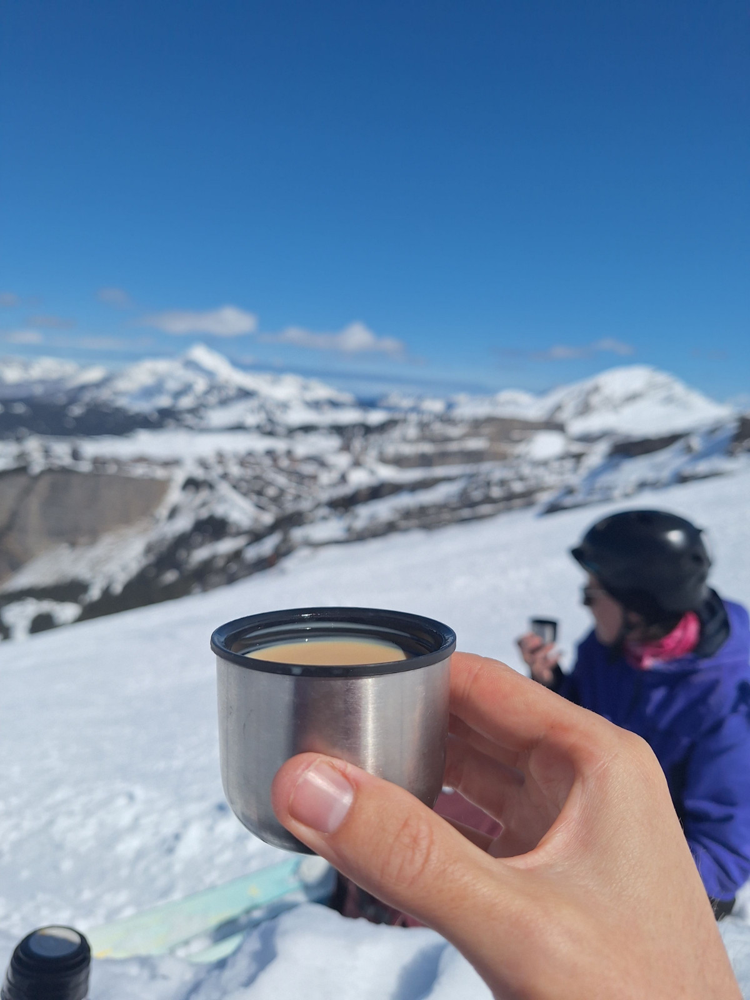

The Portes du Soleil also has plenty of salles hors-sac (picnic rooms), so you can eat your own lunch in any weather, which keeps it budget-friendly. This is part of the advantage of it being such a family-friendly resort, as they know not everyone wants to shell out at restaurants on the slopes every day.

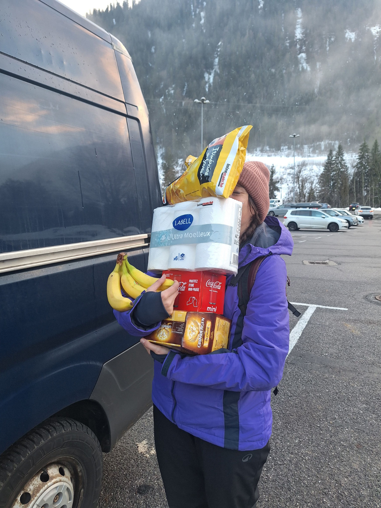

**Don’t have a campervan yet?** Wondering whether to build or buy, and what it will cost? We bought ours for £4,000, spent £1,000 on repairs and about £10,000 on the fit-out. Some people spend ski seasons in vans worth £100k+, and others get by on much less than we spent, so it all comes down to your choices and preferences, nobody is the same\!

**Season ski pass flash sales**

If you’re spending the whole season in one resort like the Portes du Soleil, you buy a winter season pass. The full price is about £1,200 for adults, but there are presales and the PdS usually does a one-day flash sale with adult passes for £600. That’s what we did for our second season once we knew what we were doing. We think that’s great value, especially when you think of how many days you can ski for £600\!

Some resorts include free day passes at other ski areas. With our Portes du Soleil pass, we got 36 additional days at various resorts, though some limit you to one day per week per resort, so read the fine print. A campervan is ideal for making the most of these, because you can move between resorts whenever you like and sleep wherever you end up. Seasonaires often don’t have that freedom, as they’re tied to their work location and may have no transport, so exploring other resorts is harder.

**

**

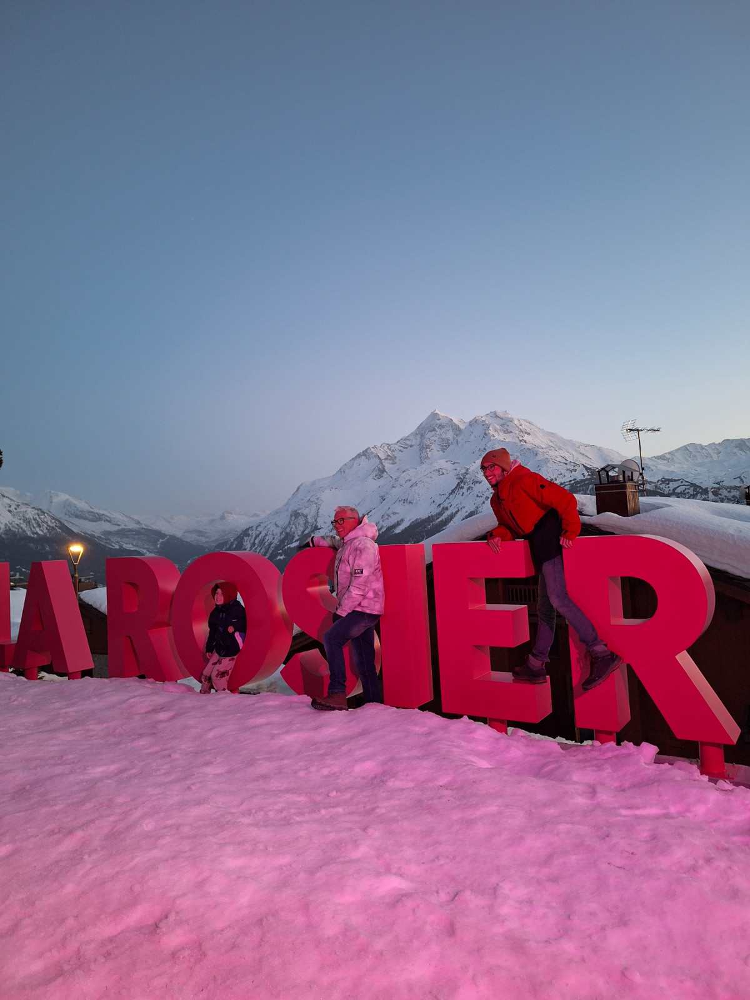

We arranged a trip with our family and met up with them in La Rosière, where we used some of our free days. We also caught up with old friends in Chamonix, and we skied in Alpe d’Huez, Saint-Gervais, Les 4 Vallées and Aletsch Arena too.

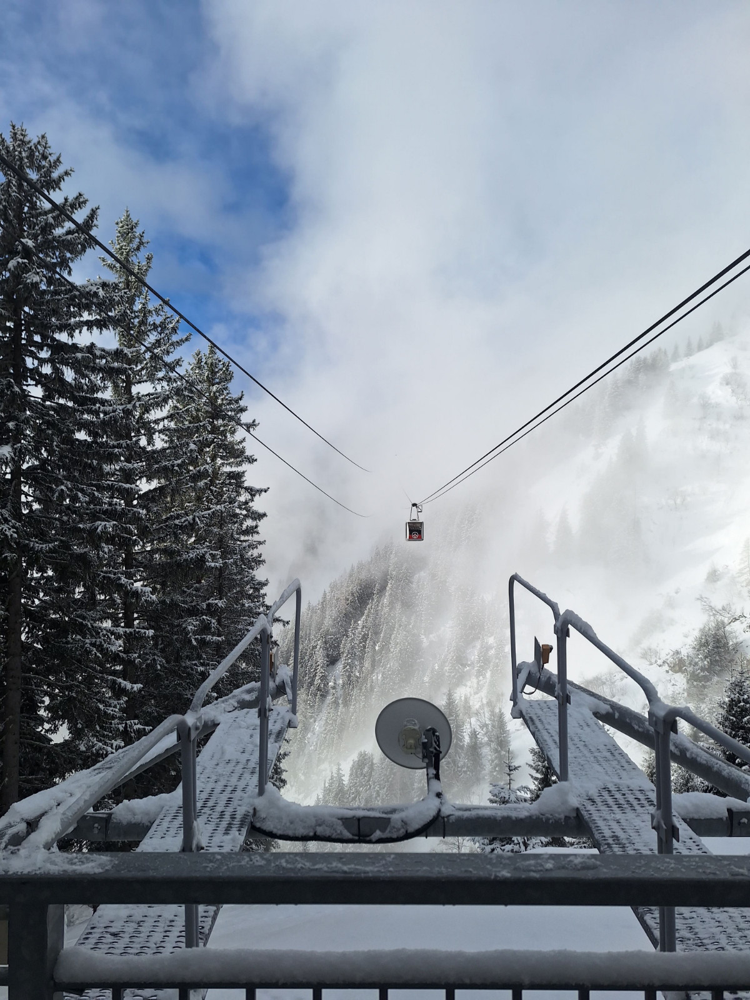

---

## Spending a ski season as a non-EU citizen

Since Brexit, UK nationals (like us) can spend only 90 days in any 180-day period in the Schengen area. If you want to spend the whole ski season abroad, you’ll need a long-stay visa.

We got a six-month French visa for our trip. There’s a lot of paperwork, and you have to show a plan for your whole trip, but it’s fairly straightforward if you can show you have enough funds to support yourself. Information about applications and requirements is on the [official French government visa website](https://www.france-visas.gouv.fr/). You can even apply for 12-month visas, and we’d love to do that someday and see the Alps in summer too.

---

## Getting there from the UK

How much time you have and your budget will probably determine how you’re going to get to the French Alps from the UK. We're the Slowmadders\! So we usually take the cheapest ferry and prefer to avoid all toll roads\! We use [ViaMichelin](https://www.viamichelin.co.uk/) to check the fuel and toll estimates for our journey.

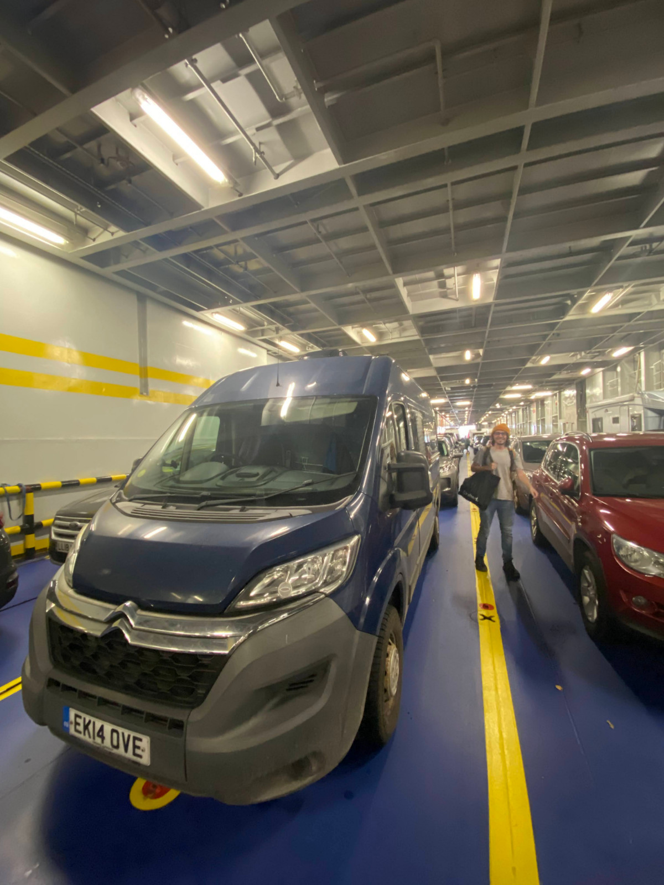

If you’ve never driven abroad before and feel nervous about it, don’t worry. Although France has a similar population to the UK, it is more than twice the size, which is why we find the roads there so quiet. We love driving in France, especially on the straight D roads that run through the middle of the country, it’s a joy\!

**Fastest way (slightly more expensive)**

The Eurotunnel vehicle train (Folkestone to Calais) will get you to France in 35 minutes and you don’t even need to leave your van. Then it's about an 8-hour drive via toll roads to reach Morzine, with toll fees around €70 each way.

**Scenic route (flexible and budget-conscious)**

If you check ferry prices on [Direct Ferries](https://www.directferries.co.uk/) you’ll see that they are usually much cheaper than the Eurotunnel. Dover to Calais is one of the quicker routes, it takes 1 hour 51 minutes. However, Newhaven to Dieppe is often the cheapest route we found which takes around 4 hours. When you get to France, you can avoid all toll roads just like you can in the UK, using Google Maps. You'll see more quaint French villages and save money too.

**Stopping off along the way**

We think that France is the easiest country to travel in a motorhome. We use the [Park4Night](https://park4night.com/) app to find many overnight spots throughout our trips. We usually look for the green motorhome symbols on the app, these are usually France’s ‘aires de camping-cars’ which often have free water, dump facilities, and sometimes free or paid electric hookup points. Most villages have free parking and are very welcoming to motorhome users.

---

## Winter driving in the Portes du Soleil

Before you leave, check the [RAC website](https://www.rac.co.uk/) for local regulations in countries you're driving through.

**Legal requirements for driving in France**

* Reflective jackets
* Warning triangle
* Headlamp beam deflectors (for UK vehicles)
* UK sticker (if your vehicle has an older 'GB' number plate)

You can buy a [Europe Travel Kit on Amazon](https://www.amazon.co.uk/s?k=europe+travel+kit) with everything included.

### Snow chains and winter tyres

Most UK vans will have summer tyres fitted. In France’s designated mountain areas in winter, which include the Portes du Soleil, you must either have tyres fitted with the three-peak mountain snowflake (3PMSF) symbol or carry snow chains. The 3PMSF symbol is usually found on winter and all-season tyres. These regulations are covered on the French Road Safety website.

We recommend carrying snow chains. As a campervan, you’re heavier than a car, and if you’ve converted the van yourself, your weight distribution may not be ideal. Chains have saved us on uphill stretches and when getting out of parkups after heavy snow in Avoriaz and Morgins. We have all-season (3PMSF) tyres fitted, but when there’s snow on the ground and we need to go uphill, we still struggle in our front-wheel drive Citroën Relay, and it can feel quite dangerous. If you have a two-wheel drive van, 3PMSF tyres won’t suddenly turn it into a 4x4. Winter tyres perform better if you’re happy to swap them in and out each season, but we chose all-seasons for year-round use and accept the slight hit to MPG.

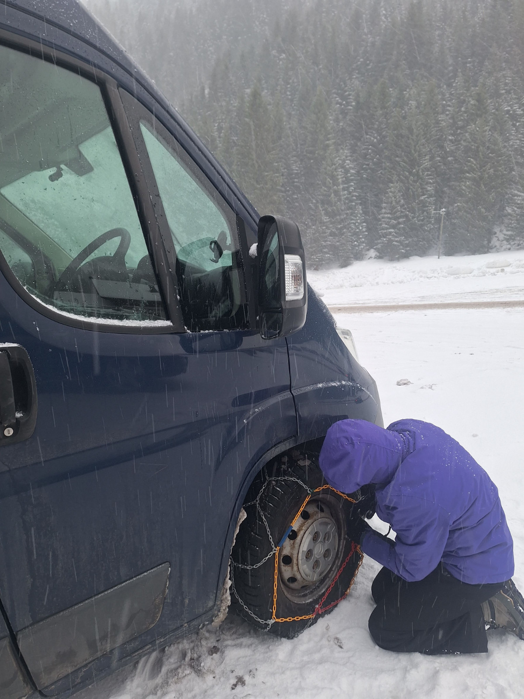

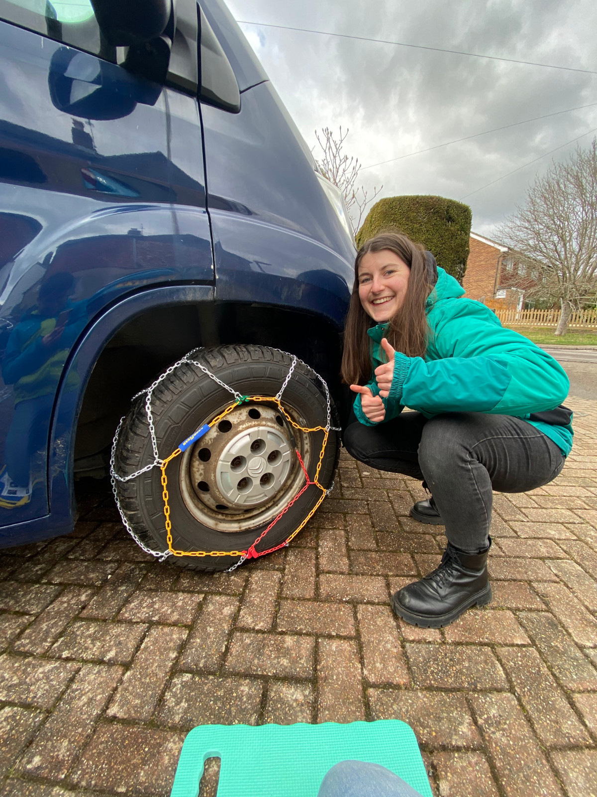

Get familiar with fitting your chains, you don't want to learn in heavy snow while you’re holding up traffic because you got stuck, or on the side of the road while other cars are sliding past you because they decided to ‘risk it’.

**Pro tip: Don’t buy the cheapest chains.** We did this and the links broke after a couple of uses. A van is heavier and more powerful than a car, so we now use 12mm Goodyear snow chains, which are sturdier and cost only £60. The cheap set had 7mm chains and cost £25, which are better suited to cars. 16mm versions are also available. Buy your chains before you travel, either online or by click-and-collect at somewhere like Norauto in France. Otherwise you risk panic buying at a local supermarket, which may only stock a few expensive models (£200+) that might not fit your tyres. Don’t assume that expensive chains are necessarily stronger, either.

**Road conditions in the Portes du Soleil**

Many resorts in the PdS are at lower altitudes with skiing higher up (like Morzine and Les Gets), so you won’t often drive on snow-covered roads unless it snows during your journey. Remember that all resorts have snow ploughs on standby to clear roads as soon as heavy snow starts falling because they need to ensure that everyone can reach the resorts easily, including big coaches\! During the two ski seasons we’ve spent living in the PdS, we’ve only had to put on snow chains a handful of times.

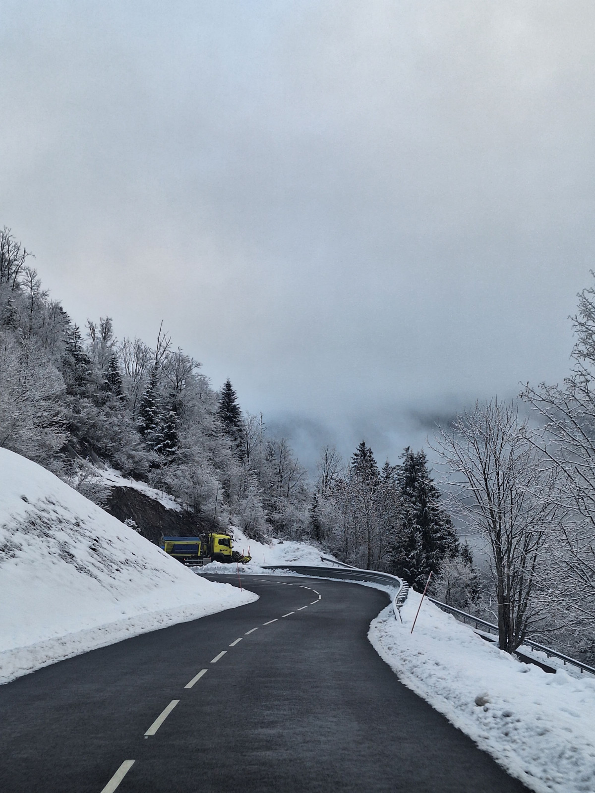

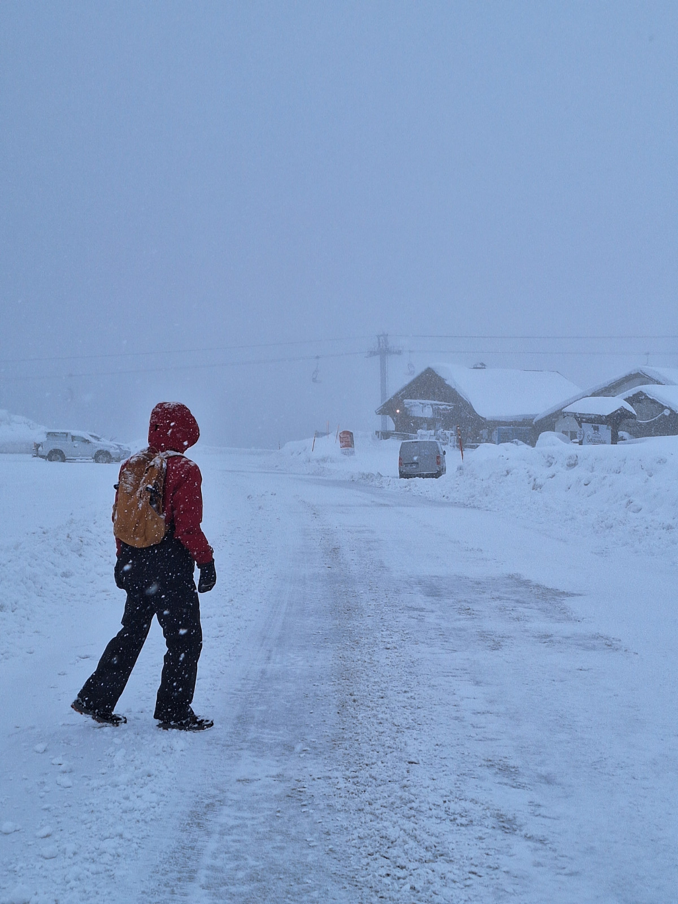

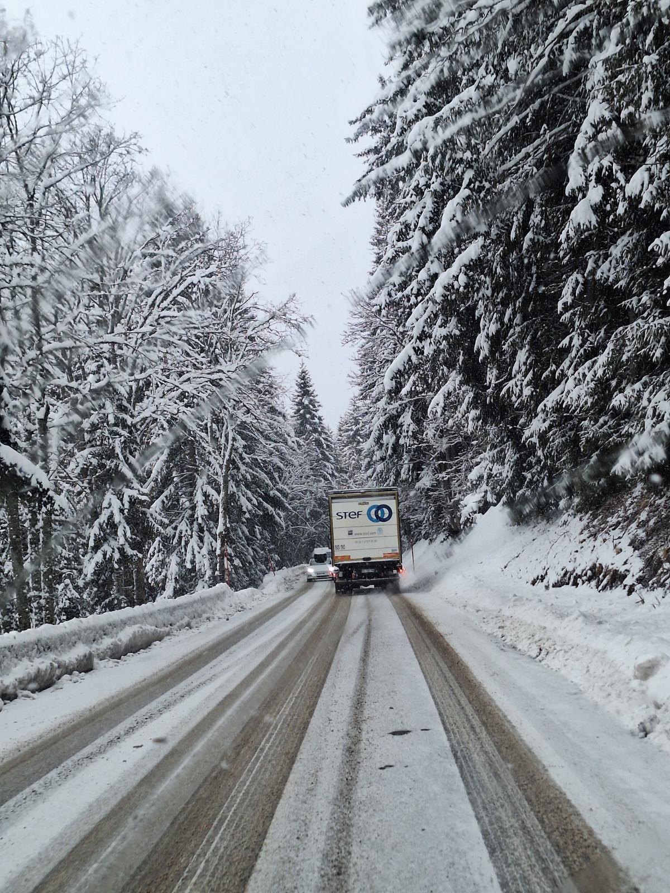

**Bring a snow shovel (and a broom)**

Bring a shovel for clearing snow around your van, especially if you’re planning on staying in the same spots for a while like we did. A broom can help you remove snow from the roof, which is important if you have solar panels as you’ll want to maximise power generation, however small\!

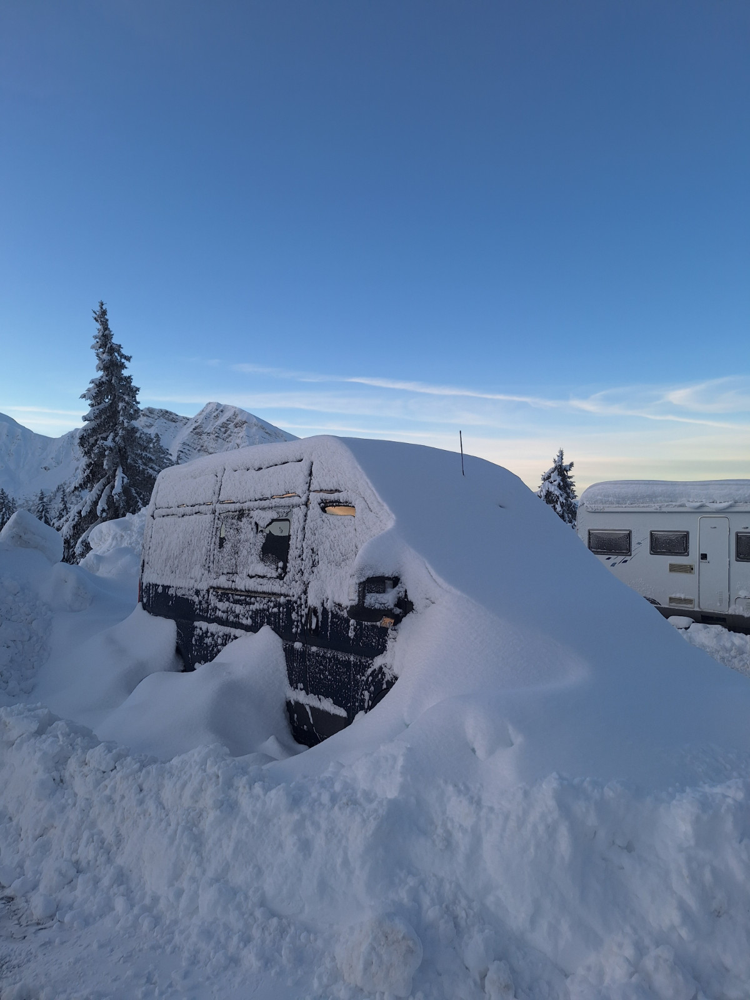

We often slept in car parks that were ploughed overnight, which left us parked in a rectangle of snow when we woke up in the morning. Because the ploughs pushed snow up around the van, the pile could end up way deeper than the actual snowfall depth, so a snow shovel was essential for this as clearing the snow was a big job.

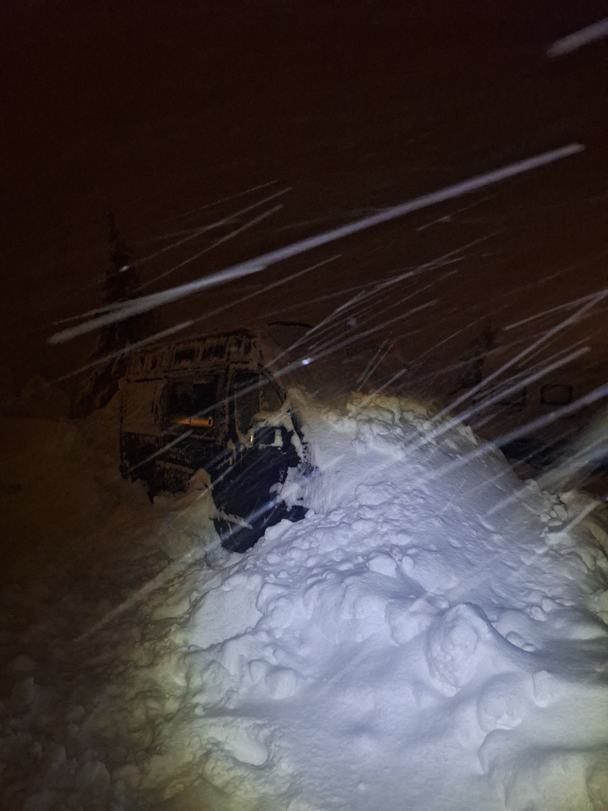

---

## Is your campervan winter-ready?

Before you set off to spend a whole winter season in your van, make sure you’re ready so you can spend the season enjoying the slopes instead of fixing problems. When we finished building our van conversion we went to the Peak District to give our build a bit of a dry run so we could sort out any niggles while we were still in the UK.

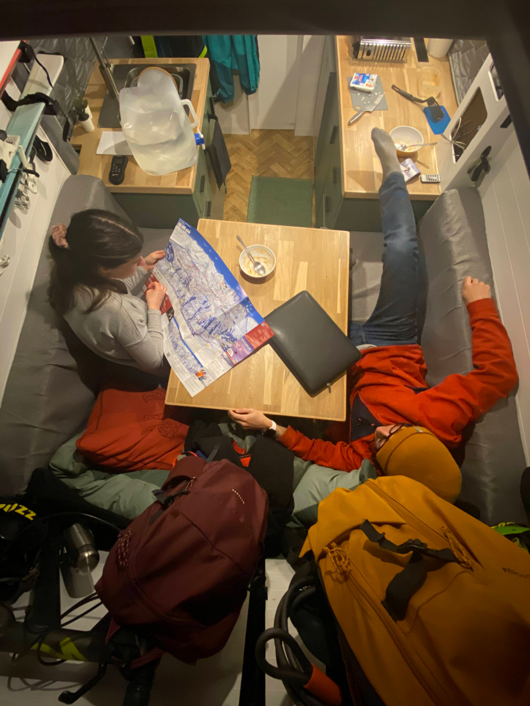

### How will you manage power in winter?

Van life in the winter is different from van life in the summer. Lots of people utilise solar panels during the summer or rely on campsites to plug in, but solar panels don’t produce much juice in the winter and campsites are more scarce, so we’d recommend having other options.

It all depends on your needs, work out how much power you’re going to need every day. The Far Out Ride blog’s [van electricity calculator](https://faroutride.com/van-electrical-calculator/) is great for this.

**Ways to charge the leisure batteries in the winter**

**Drive around:** We have a DC-DC charger fitted in our van, so we can charge our leisure batteries using power from our engine’s alternator while we move spots or drive for the weekly shop. This is the number one way for us, and keeps us topped up through the winter. If you’re tempted to just idle your van to charge, if it’s diesel, check if it has a DPF. Because we did, and made this mistake during our first season and doing this caused issues with our DPF later.

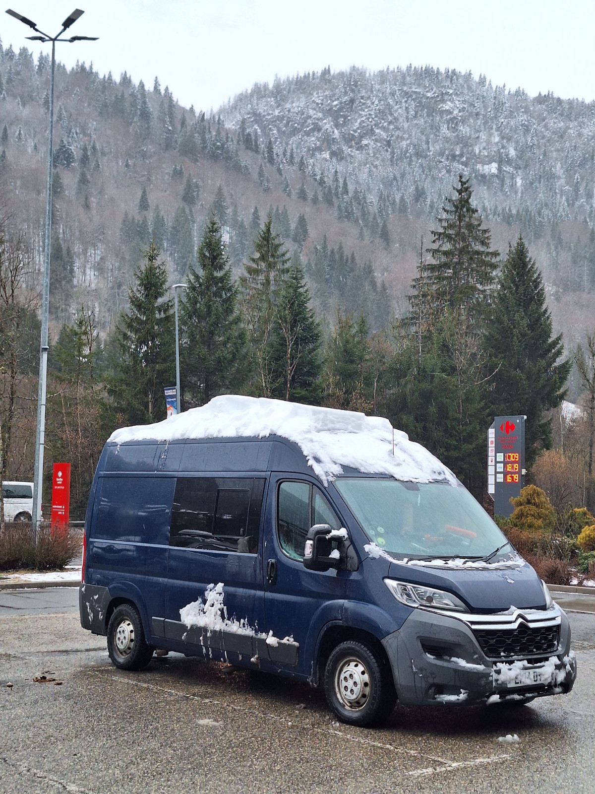

**Utilise the small amount of sun:** We have solar panels which helps a little on bluebird days, especially if you’re parked at a high altitude. You’ll get a little trickle of power from the sun in winter.

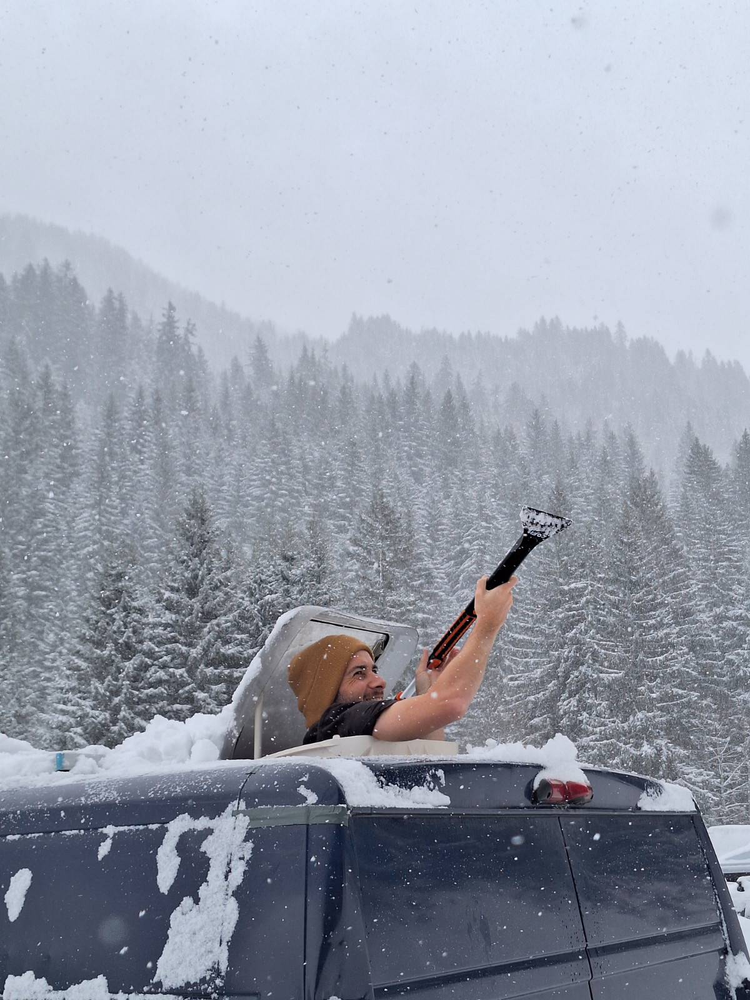

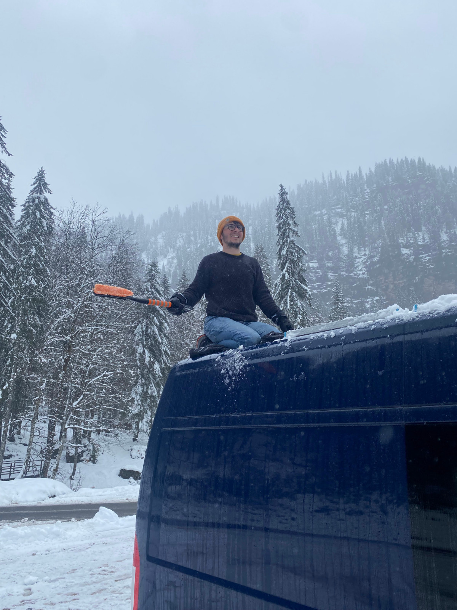

**Plug in to the grid:** We have a simple 12V battery smart charger in our van setup with an electric hookup cable so we can go to an electric hookup point in a pinch.

**Use a diesel generator:** Many carry one and use diesel to generate power, plugging into the van's hookup point. They’re noisy though, so you might be unpopular if you park close to others.

Our first ski season spent in the van had mild conditions and little snow. We managed with frequent driving topping up using the DC-DC charger and a little power from the solar panels also. We didn't plug in all season. Our second season had more intense snow and mountain conditions. We had to plug in twice, still not bad, though we upgraded to 600Ah of leisure battery, which helped.

**Note on leisure batteries in cold temperatures**

AGM leisure batteries will keep working in extreme cold, down to about \-40°C (-40°F), and can be charged down to about \-20°C (-4°F). Lithium (LiFePO4) batteries behave differently. They’ll keep working down to about \-20°C (-4°F), which is still very good, but most can’t be charged below 0°C (32°F). That means solar or alternator charging may be blocked until the battery warms up.

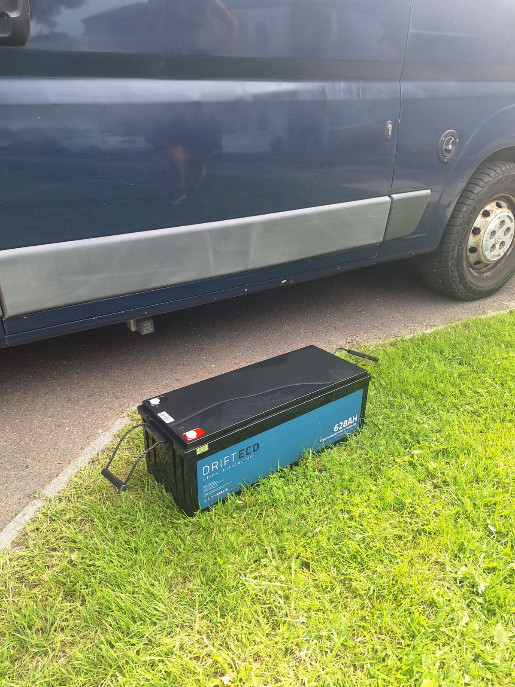

We had AGM batteries in our first season and switched to LiFePO4 for our second. We had no problems with the LiFePO4 because they sit inside the van with some airflow, so heat can reach them. By the time the sun came up and the solar kicked in, the van was usually warm enough for the batteries to accept a charge. The one risk is driving off early on a very cold morning before you’ve heated the van, when the alternator may not be able to charge them. But that’s just an excuse to wait a few minutes and have a coffee. Some people fit heated LiFePO4 batteries to get around this, but we didn’t think it was worth it given the above.

**Do you really need to run a fridge in the alps in winter?**

The fridge is one of the biggest power consumers for us. But winter has one advantage, you can turn it off and use it as a cool box instead\! Or if your cab is separate from your living space like ours, leave stuff in there overnight or even on the roof. We got quite creative, in ski resorts, we’d fill a container with snow and place it in the fridge to keep things cold. It sounds mad but it works. Trust\! Use a thermometer to monitor food temps.

### How will you stay warm in your van?

When people hear we spent winter in a van in a ski resort, the first question is always “Don’t you get cold in there?” (that or “Where do you poop?”, anyway\!). But nobody asks that about a ski chalet in winter, because it has heating, and so should a campervan prepared for a winter ski season\! Without it you’d be miserable in a chalet or a van. A van also heats up extremely fast, because there’s so little space to warm.

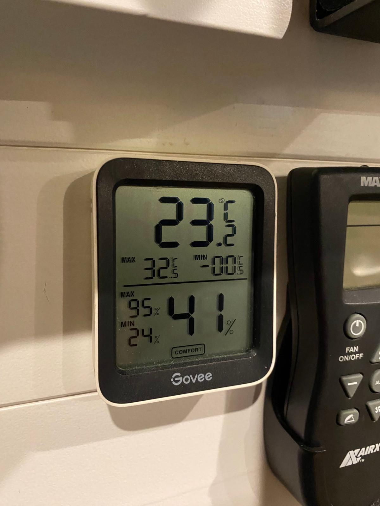

**Ways to heat the van in winter**

We installed a Chinese diesel heater. It's been very reliable across two seasons, it hasn't skipped a beat. Cost us about £80 and it's been in since 2022\. We plumbed the heater directly into our diesel tank; if you have a petrol van or want a simpler install, carry diesel in a separate tank and connect to that.

Some opt for gas heaters and it’s an option but uses a lot of LPG and you'll have to refill regularly, especially if you’re using it for cooking too. But it is another popular option.

Is it cold with a heater? No\! Many times we've had to crack a window because it's too hot on the lowest setting. We never ran it overnight either, even at \-14°C (7°F) outside, a thick duvet keeps us warm once you turn it off in the evening. (Just don't stick a limb outside the duvet or you might die\!)

### Does your van have insulation?

Many UK motorhomes, especially coach-built ones, are designed for summer use, so their insulation may not be great. The same goes for self-conversions where winter wasn’t considered during the build, so it’s worth thinking about.

If you have a heater, insulation might not be essential, but a poorly insulated van can lose heat quickly, so you’ll use the heater more and may need to run it overnight. Bare metal surfaces are also worth covering as they might be cold to the touch and collect condensation from your breath overnight, so we’d recommend covering them with carpet as a minimum.

We insulated our floor, ceiling and walls with a mix of PIR board and recycled plastic bottle insulation, which we think keeps the heat in longer. Because we built our van with skiing in mind, we also have a 40mm insulated wall with a sliding door separating the cab from the living area. We treat the cab as the outside, so we don’t insulate the windscreen. If your cab is part of your living space, insulated windscreen covers are worth considering also.

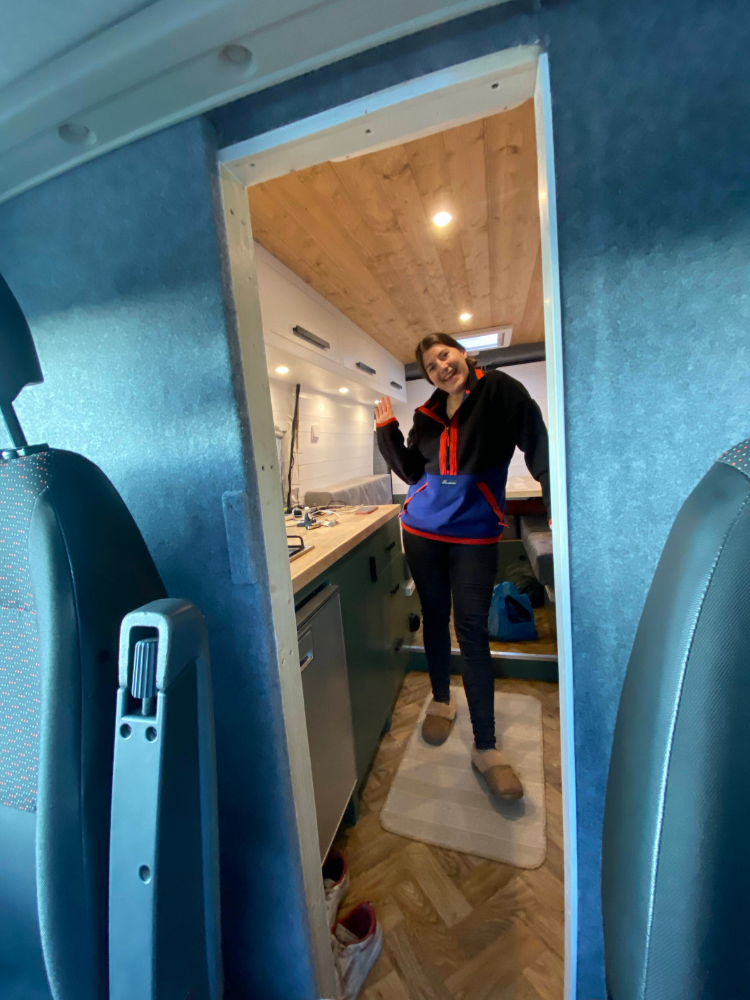

### How will your water system cope in the cold?

If you plan to live in a ski resort in your van, especially at higher-altitude spots, think about how your water system will cope in freezing temperatures and have a plan.

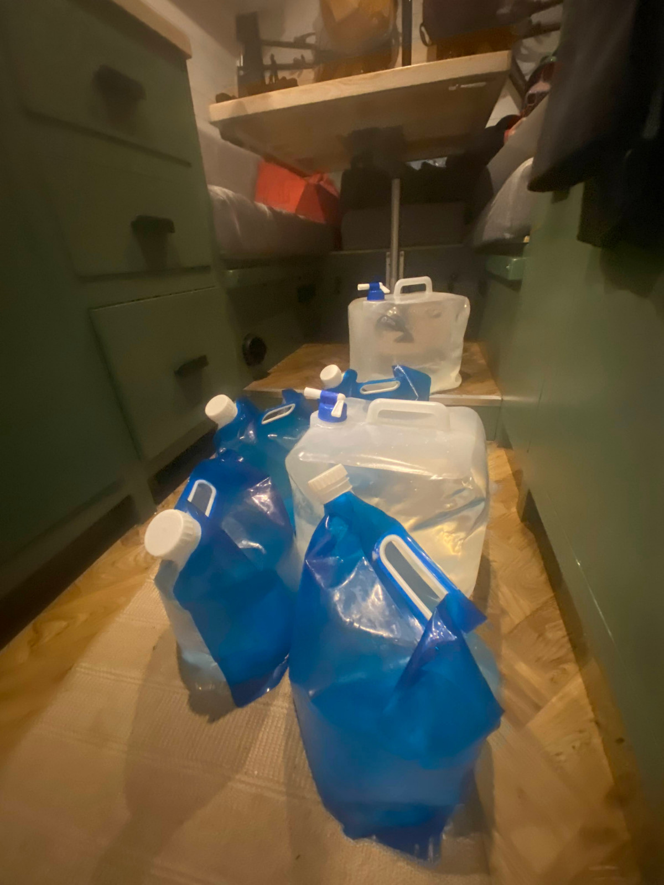

Underslung external tanks are the most at risk, because they’re exposed to the outside air and get no help from your heating. Internal tanks and pipes usually won’t freeze, because you’re living in the van and keeping it heated. Just make sure there’s airflow to wherever they’re fitted, so the heat can reach them. In either case, pipes tend to freeze before tanks, as they hold far less water, while the sheer volume of water in a tank takes much longer to freeze.

You can wrap external tanks and pipes in insulation, which buys you time but won’t prevent freezing in very cold weather. Some people fit electric heater pads to their tanks, but we prefer to keep things simple and conserve power, so we didn’t bother.

Our tanks are underslung, so our strategy was just to have a backup plan and check the forecast for the altitude where we were parked. If it was due to drop below \-5°C (23°F) overnight for example, we’d drain the tanks and use a 20L container of water kept inside the van instead. That’s less convenient, as you can’t just turn on a tap, but it didn’t happen very often. If space allowed, we’d keep the tanks inside so they stayed warmer, but our van is small and it wasn’t frequent enough to be worth the trouble.

### Do you have a backup plan if it goes wrong?

Winter is the worst time for something to fail, so it’s worth having a backup for the essentials, starting with power. Most people have several ways to charge their batteries, such as hookup, alternator charging and solar. We didn’t build a hookup into our van, to keep things simple, but we did buy a cheap 12V battery charger so we can still plug in to an electric hookup point if we need to.

Heat is the other essential. We carry a cheap, small electric heater, so if our diesel heater breaks we’re not stuck. We can find somewhere with power, plug in the electric heater and work out the fix.

---

## Getting internet in the mountains

Connectivity in the French Alps is better than you might expect. We’re used to struggling for mobile signal in the UK, but we didn’t find that in the Alps, probably because you’re rarely far from a big resort mast and you’re high up. We used mobile internet for our entire trip, working on laptops every day and making frequent video calls.

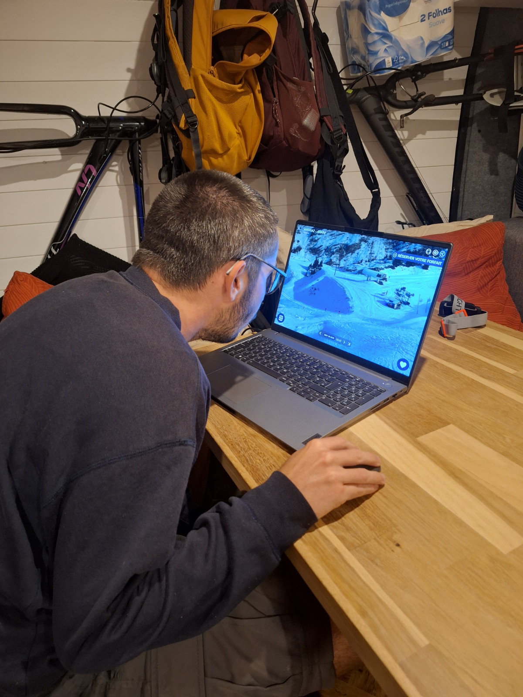

Our setup is simple: a cheap second-hand Samsung phone (with a cracked screen\!), which we call our burner phone, acting as a dedicated router. We stick it in the van’s skylight on a magnetic mount, which gets around the fact that a metal van is a bit of a Faraday cage. You could also put it near the windscreen.

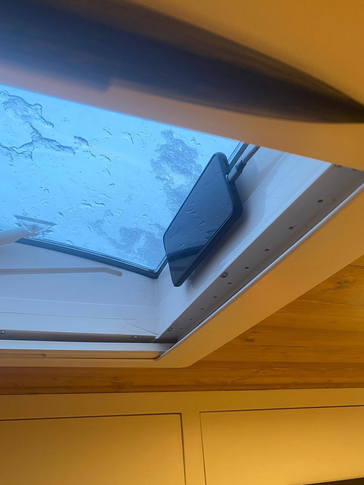

It’s easy to end up buying a 12V router and external antenna because you’ve seen them on YouTube, but specialist “van life” kit costs more because it’s made for a small market. A phone is made for the mass market, so it’s cheaper, and we’d guess the modem inside is as good or better. It does the job for us. We usually run two mobile plans at once as a backup, which is easy with a dual-SIM phone, or with eSIMs you can store several and switch between them.

If you have a UK plan, check what it covers in France, as providers often cap roaming, especially on unlimited plans. International eSIM providers such as Airalo, Holafly and Roamless are often promoted on blogs like this because of affiliate links. They suit short trips, but for a long stay with lots of data they get expensive. Local providers are always more cost-effective, and we buy local eSIMs online so we don’t have to find a mobile shop in a larger town. Two worth looking at:

**Local providers for mobile internet in France**

* [Lebara.fr](https://www.lebara.fr/): 350GB eSIM for €13.99 (30 days)
* [Bouygues Telecom](https://www.bouyguestelecom.fr/): 130GB eSIM for €19.99 (30 days)

We didn’t use Starlink, a satellite dish that mounts on your van, though many people swear by it. The downsides are cost and high power consumption (especially relevant during winter), and mobile internet worked fine for us at a fraction of the price. An eSIM also goes with you when you leave the van, whereas with Starlink you’d still want a mobile plan for data on the go anyway.

Our only real problem came once, during heavy snow in the school holidays in Avoriaz. Many lifts were closed, so the resort was packed with people who couldn’t ski, and the network was so overloaded that we had to ski into town and find a cafe with wifi. Otherwise dropouts were rare, and we’ve had no major issues anywhere in Europe.

**Note on data in Switzerland**

Switzerland is not part of the EU/EEA, so it isn’t always covered by “roam like at home” rules, whether you have a UK plan or a French eSIM. Rules vary between providers, so check your plan. You could be hit with surprise charges if you drive or ski into Switzerland, or even wander too close to the border, so if you’re using a French provider, turn off data roaming until you’re sure of the rules. We got caught out a couple of times because we kept forgetting\!

If you need data in Switzerland, we found Digital Republic a good eSIM option, though it doesn’t offer unlimited plans. Lyca Mobile Switzerland has larger plans, including unlimited ones, but our experience of its connection quality across the countries it operates in has been inconsistent.
